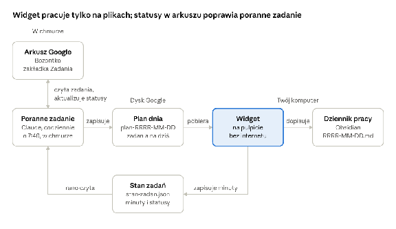
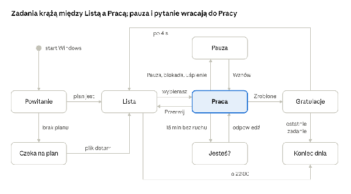

# Asystentka na pulpit — grafiki i specyfikacja v1

Oct 29, 2026 · @Paweł

Widget to postać chibi w prawym dolnym rogu ekranu. Wita Cię po starcie Windows, pokazuje plan dnia z porannego zadania, liczy czas wybranego zadania z możliwością pauzy i zapisuje wykonaną pracę do dziennika w Obsidianie. Widget nie korzysta z LLM ani z internetu: czyta i zapisuje wyłącznie pliki na dysku.

Część A jest dla Ciebie: 12 grafik obowiązkowych i 8 opcjonalnych do wygenerowania w Gemini, z gotowymi promptami. Część B jest dla Claude Code: wyeksportuj dokument do Markdown i zapisz go w folderze projektu jako SPEC.md.

## Część A — grafiki do wygenerowania w Gemini

### A1. Zasady dla wszystkich grafik

Każda poza to osobny kwadratowy PNG z tą samą postacią, w tym samym kadrze i skali, na jednolitym zielonym tle. Gemini nie tworzy przezroczystego tła ([forum Google AI](https://discuss.ai.google.dev/t/unable-to-create-transparent-pngs/92868)), więc zieleń usuniemy po wygenerowaniu, jak w [poradniku Phila Schmida](https://www.philschmid.de/generate-stickers).

| Zasada | Wartość |
| :---- | :---- |
| Format | PNG, kwadrat 1:1, najlepiej 1024 × 1024 px lub więcej |
| Tło | jednolita zieleń \#00FF00, bez gradientu, cienia i podłogi |
| Kadr | cała postać, wyśrodkowana, ok. 10% marginesu dookoła |
| Linia bazowa | dół postaci (stopy albo miejsce siedzenia) zawsze na tej samej wysokości |
| Kąt | widok 3/4, postać zwrócona lekko w lewo, bo widget stoi w prawym dolnym rogu ekranu; wzorzec i ikona przodem |
| Obrys | cienki biały obrys wokół postaci, jak na naklejce |
| Zakazy | zieleń na postaci, napisy i logo na ubraniu, poświaty i półprzezroczyste efekty |
| Nazwy plików | dokładnie jak w A3, małymi literami, np. sit\_watch.png |

Skąd te zasady: zieleń na postaci zniknie razem z tłem, a poświaty zamienią się w zielone obwódki, więc neon dodamy w kodzie. Biały obrys ułatwia wycinanie i trzyma postać czytelną na każdej tapecie. Napisy na ubraniu odwróciłyby się, gdy widget odbije postać lustrzanie w lewym rogu ekranu.

### A2. Karta postaci

Proponuję oryginalną bohaterkę w klimacie cyberpunkowej AI-towarzyszki. Przy 200 px wysokości rozpoznawalność dają jej dwie rzeczy: wysoki kucyk z boku i duże słuchawki z anteną. Każdą cechę możesz zmienić, byle zmiana trafiła też do promptu wzorca w A4.

| Cecha | Propozycja |
| :---- | :---- |
| Imię | do wyboru, np. Bajtka albo Neonka |
| Proporcje | chibi, ok. 2,5 głowy wzrostu |
| Włosy | lawendowe z brzoskwiniowymi końcówkami, wysoki kucyk z boku |
| Oczy | duże, bursztynowe |
| Strój | za duża pastelowożółta kurtka techwear z cienkimi cyjanowymi szwami, granatowe szorty, białe masywne sneakersy |
| Znak rozpoznawczy | duże okrągłe słuchawki z małą anteną zakończoną kulką |
| Charakter | pogodna, trochę zadziorna; kibicuje, zamiast zrzędzić |

Ta sama paleta będzie motywem interfejsu, więc postać i panel wyglądają jak jedna całość. Zieleni w niej nie ma celowo (A1).

| Kolor | Hex | Na postaci | W interfejsie |
| :---- | :---- | :---- | :---- |
| Lawenda | \#B9A6FF | włosy | ramka panelu |
| Brzoskwinia | \#FFB59A | końcówki włosów | pasek czasu po przekroczeniu szacunku |
| Żółty | \#FFD84D | kurtka | przycisk „Zrobione” |
| Cyjan | \#2EDBE8 | szwy, antena | licznik, pasek czasu, poświata |
| Granat | \#1E2140 | szorty | tło panelu |

### A2b. Wariant B: ostra kreska i nastoletnia sylwetka

To alternatywa dla chibi z A2: ta sama bohaterka, narysowana ostrą, kanciastą kreską, z proporcjami i mimiką nastolatki. Znaki rozpoznawcze i paleta zostają, więc oba warianty porównasz jeden do jednego, a interfejs i lista grafik się nie zmieniają. Prompty celowo nie odwołują się do żadnego serialu ani postaci, żeby Gemini nie skopiował cudzego projektu i maskotka została Twoja.

| Cecha | Wariant B |
| :---- | :---- |
| Proporcje | smukła, młodzieńcza sylwetka, ok. 6,5 głowy wzrostu |
| Kreska | ostre, kanciaste kontury o zmiennej grubości, płaskie cieniowanie z twardymi krawędziami cieni, mocne graficzne kształty |
| Twarz i mimika | wyraziste, lekko zwężone bursztynowe oczy z grubą górną linią rzęs; mimika nastolatki: zadziorny uśmieszek, uniesiona brew, nadąsane policzki, głośny śmiech |
| Włosy | lawendowe z brzoskwiniowymi końcówkami, wysoki kucyk z boku, ostre pasma i asymetryczna grzywka |
| Strój | za duża pastelowożółta kurtka techwear z cyjanowymi szwami, granatowe bojówki, białe masywne sneakersy |
| Znak rozpoznawczy | bez zmian: duże okrągłe słuchawki z anteną zakończoną kulką |
| Paleta | bez zmian, jak w A2 |

**Wzorzec.** W kroku 1 z A4 użyj tego promptu zamiast wersji chibi.

```text
Original anime girl in her late teens, full body, slim youthful build, about 6.5 heads tall, standing, front view, relaxed confident pose, slight smirk.
Hair: lavender with peach tips, high side ponytail, sharp angular strands, asymmetric bangs. Sharp amber eyes with a bold upper lash line.
Outfit: oversized pastel yellow techwear jacket with thin cyan seams, navy cargo pants, chunky white sneakers.
Signature accessory: large round headphones with a small antenna ending in a little ball.
Style: sharp angular line art, crisp contours with varied line weight, flat cel shading with hard-edged shadows, bold graphic shapes, energetic cyberpunk anime look, thin white sticker outline around the character.
Background: solid flat chroma key green, exactly #00FF00, uniform, no gradient, no shadow, no floor.
No green anywhere on the character. No text, no logos, no glow effects.
Character centered, whole body visible with about 10% margin. Square image, 1:1.
```

**Pozy.** Szablon z kroku 2 w A4 zostaje bez zmian: \[POSE\] bierzesz z tabeli w A4, a \[EXPRESSION\] z tej. Mrugnięcia i ikona też idą według A4, bo styl przejdzie z wzorca.

| Plik | \[EXPRESSION\] w wariancie B |
| :---- | :---- |
| stand\_idle | relaxed half-smile, one eyebrow slightly raised |
| wave\_1 | big grin, bright eyes |
| wave\_2 | big grin, bright eyes |
| point | confident smirk |
| sit\_watch | focused, slight smirk |
| sit\_watch\_front | playful smile, head slightly tilted |
| sit\_console\_1 | intense focus, eyes narrowed |
| sit\_console\_2 | triumphant grin |
| sit\_drink | content, eyes half closed |
| pause\_stretch | eyes closed, big yawn |
| pause\_nap | asleep, mouth slightly open |
| idle\_check | suspicious squint, puffed cheeks |
| cheer\_1 | laughing with eyes closed |
| cheer\_2 | wink and cocky grin |
| bye | sleepy, half-lidded eyes, lazy smile |
| loading | thinking, slight pout |

**Co wariant B zmienia w widgecie**

* Postać potrzebuje ok. 280 px wysokości zamiast 200 px (B6). Przy 6,5 głowy wzrostu twarz ma wtedy ok. 43 px, a przy 200 px tylko ok. 31 px. Chibi przy 200 px ma głowę ok. 80 px.  
* Mimika musi być rysowana dużymi kształtami oczu i ust, bez drobnych detali, które znikną po zmniejszeniu.  
* Oddech powinien być delikatniejszy: skala do 1,008 zamiast 1,015 (B7).  
* Lista plików, stany i reszta specyfikacji zostają bez zmian.

Jak wybrać: wygeneruj oba wzorce i zmniejsz je do docelowej wysokości, 200 px dla chibi i 280 px dla wariantu B. Wygrywa ta wersja, której mimikę czytasz z normalnej odległości od monitora.

### A3. Lista grafik

Do działającego widgetu wystarczy 12 grafik z pierwszej tabeli, a 8 opcjonalnych dodaje urozmaicenia. Brakującą grafikę opcjonalną widget zastąpi podstawową pozą z tej samej grupy. Status odhaczaj w ostatniej kolumnie.

**Obowiązkowe (12)**

| Plik | Kiedy się pokazuje | Poza i mina | Status |
| :---- | :---- | :---- | :---- |
| ref\_master.png | nigdy: to wzorzec do kolejnych promptów | stoi przodem, neutralnie, lekki uśmiech | Gotowe |
| stand\_idle.png | lista zadań, czekanie na wybór | stoi, ręce luźno, łagodny uśmiech | Do zrobienia |
| stand\_idle\_blink.png | mrugnięcie przy liście | jak wyżej, oczy zamknięte | Do zrobienia |
| wave\_1.png | powitanie po starcie komputera | stoi i macha uniesioną ręką, szeroki uśmiech | Do zrobienia |
| sit\_watch.png | licznik działa | siedzi po turecku, patrzy w lewo i w górę, na ekran | Do zrobienia |
| sit\_watch\_blink.png | mrugnięcie przy pracy | jak wyżej, oczy zamknięte | Do zrobienia |
| sit\_console\_1.png | licznik działa, wariant | siedzi po turecku, gra na małej konsolce, skupiona | Do zrobienia |
| pause\_stretch.png | pauza | siedzi i przeciąga się z rękami nad głową | Do zrobienia |
| idle\_check.png | pytanie „Jesteś?” po bezczynności | stoi pochylona, dłoń nad oczami, zaciekawiona | Do zrobienia |
| cheer\_1.png | ukończone zadanie | na palcach, obie ręce w górze, oczy zmrużone z radości | Do zrobienia |
| bye.png | koniec dnia | macha na pożegnanie, zaspany uśmiech | Do zrobienia |
| icon.png | ikona aplikacji i zasobnika | sama głowa ze słuchawkami, przodem, uśmiech | Do zrobienia |

**Opcjonalne (8)**

| Plik | Kiedy się pokazuje | Poza i mina | Status |
| :---- | :---- | :---- | :---- |
| wave\_2.png | druga klatka machania | ręka przechylona w drugą stronę | Do zrobienia |
| point.png | pokazywanie planu | wskazuje palcem w lewo, na listę | Do zrobienia |
| sit\_watch\_front.png | praca, gdy kursor jest blisko widgetu | siedzi po turecku, patrzy na Ciebie, uśmiech | Do zrobienia |
| sit\_console\_2.png | druga klatka konsoli | jak sit\_console\_1, język na wierzchu z emocji | Do zrobienia |
| sit\_drink.png | licznik działa, wariant | siedzi, pije bubble tea przez słomkę | Do zrobienia |
| pause\_nap.png | pauza dłuższa niż 15 min | drzemie na siedząco, głowa przechylona | Do zrobienia |
| cheer\_2.png | druga klatka gratulacji | stoi, pokazuje znak V, puszcza oczko | Do zrobienia |
| loading.png | plan dnia jeszcze nie dotarł | stuka palcem w mały unoszący się ekran | Do zrobienia |

Pozy siedzące rysujemy po turecku, na niewidzialnej półce: w widgecie postać siedzi na górnej krawędzi panelu z zadaniem.

### A4. Prompty do Gemini

Pracuj w trzech krokach: najpierw wzorzec, potem pozy z wzorcem w załączniku, na końcu mrugnięcia jako edycja gotowej pozy. Prompty są po angielsku, żeby we wszystkich powtarzały się te same słowa kluczowe. Zmieniasz tylko fragmenty w nawiasach kwadratowych.

**Krok 1\. Wzorzec.** Wygeneruj kilka wersji, wybierz najlepszą i zapisz ją jako ref\_master.png.

```text
Original chibi anime girl, full body, about 2.5 heads tall, standing, front view, neutral pose, gentle smile.
Hair: lavender with peach tips, high side ponytail. Big amber eyes.
Outfit: oversized pastel yellow techwear jacket with thin cyan seams, navy shorts, chunky white sneakers.
Signature accessory: large round headphones with a small antenna ending in a little ball.
Style: clean bold line art, flat cel shading, cute cyberpunk vibe, thin white sticker outline around the character.
Background: solid flat chroma key green, exactly #00FF00, uniform, no gradient, no shadow, no floor.
No green anywhere on the character. No text, no logos, no glow effects.
Character centered, whole body visible with about 10% margin. Square image, 1:1.
```

**Krok 2\. Pozy.** W nowej wiadomości dołącz ref\_master.png, a przy pozach siedzących także gotowy sit\_watch.png. Wklej szablon i wstaw do nawiasów wartości z tabeli.

```text
Use the attached image as the character reference. Draw the SAME character: same face, hair, outfit, colors, proportions, line art and shading.
New pose: [POSE]
Expression: [EXPRESSION]
Three-quarter view, body turned slightly to the left. Same scale as the reference. Whole body visible, centered, bottom of the character at the same height as in the reference.
Thin white sticker outline. Background: solid flat chroma key green, exactly #00FF00, no gradient, no shadow, no floor.
No green on the character, no text, no logos, no glow effects. Square image, 1:1.
```

| Plik | \[POSE\] | \[EXPRESSION\] |
| :---- | :---- | :---- |
| stand\_idle | standing relaxed, arms loose at her sides | soft smile |
| wave\_1 | standing, waving with one hand raised high | big happy smile |
| wave\_2 | standing, waving, the raised hand tilted to the other side | big happy smile |
| point | standing, pointing with her index finger to the left side of the image | cheerful, mouth slightly open |
| sit\_watch | sitting cross-legged on an invisible flat ledge, hands on her knees, looking up and to the left | focused, slight smile |
| sit\_watch\_front | sitting cross-legged on an invisible flat ledge, looking straight at the viewer | warm smile |
| sit\_console\_1 | sitting cross-legged on an invisible flat ledge, holding a small handheld game console in both hands, looking down at it | concentrated |
| sit\_console\_2 | sitting cross-legged on an invisible flat ledge, holding a small handheld game console, leaning slightly forward | excited, tongue slightly out |
| sit\_drink | sitting cross-legged on an invisible flat ledge, sipping bubble tea through a straw, cup held in both hands | content, eyes half closed |
| pause\_stretch | sitting cross-legged on an invisible flat ledge, stretching both arms above her head | relaxed, eyes closed |
| pause\_nap | sitting cross-legged on an invisible flat ledge, dozing off, head tilted to one side | asleep, peaceful |
| idle\_check | standing, leaning forward, one hand above her eyes as if looking for someone | curious, puzzled |
| cheer\_1 | standing on tiptoes, both arms raised high in celebration | overjoyed, eyes closed in happy arcs |
| cheer\_2 | standing, making a peace sign with one hand | winking, big grin |
| bye | standing, waving goodbye with one hand | sleepy smile, eyes half closed |
| loading | standing, tapping a small floating rectangular screen in front of her with one finger | thinking, slightly puzzled |

**Krok 3\. Mrugnięcia.** Dołącz gotową pozę (stand\_idle.png albo sit\_watch.png) i wpisz:

```text
Edit the attached image: close her eyes as in a natural blink, drawn as two soft curved lines. Change nothing else: same pose, outfit, colors, outline, framing and green background.
```

**Ikona.** Dołącz ref\_master.png i wpisz:

```text
Use the attached image as the character reference. Draw only her head with the headphones, front view, simple shapes and bold outlines that stay readable at 16 x 16 pixels, cheerful smile. Thin white sticker outline. Background: solid flat chroma key green, exactly #00FF00. Square image, 1:1.
```

**Gdy coś idzie nie tak**

* Gemini zmienia proporcje obrazu: dołącz jako ostatnią pustą kwadratową kanwę i napisz, że to układ do użycia ([opis obejścia](https://workalizer.com/blog/apps-tools/mastering-geminis-image-aspect-ratios-tips-for-google-workspace-creators)). Plik kanwa\_1x1.png dostaniesz ode mnie w czacie.  
* Postać dryfuje (inna twarz albo kolory): zacznij nowy czat i dołącz wzorzec oraz najbliższą udaną pozę.  
* Na tle pojawia się cień albo gradient: dopisz na końcu promptu „flat background, absolutely no shading on the background”.  
* Generuj po 2–4 wersje każdej pozy i zacznij od wszystkich obowiązkowych.

### A5. Co zrobić z gotowymi plikami

Wrzuć mi gotowe PNG w czacie, a przygotuję z nich paczkę postac/ do projektu.

1. Usunę zielone tło kluczowaniem koloru, jak w [poradniku Phila Schmida](https://www.philschmid.de/generate-stickers), i oczyszczę krawędzie.  
2. Wyrównam skalę i linię bazową, żeby pozy nie skakały przy podmianie.  
3. Jeśli przy mrugnięciu Gemini przesunie coś poza oczami, wkleję same oczy do oryginalnej pozy.  
4. Z icon.png Tauri zrobi wszystkie rozmiary ikon dla Windows jedną komendą tauri icon.  
5. Odeślę gotowy folder do wrzucenia w src/assets/postac/.

## Część B — specyfikacja v1 (dla Claude Code)

### B1. Cel i zakres v1

v1 to lokalny widget na Windows 10 (wersja 2004 lub nowsza) i 11: plan dnia z pliku, licznik z pauzą, dziennik w Obsidianie i postać, która reaguje na każdy z tych momentów. Widget nie łączy się z internetem i nie zmienia żadnych plików poza swoimi.

**W zakresie v1**

* autostart z Windows, powitanie i lista zadań na dziś;  
* licznik czasu na wybranym zadaniu, pauza ręczna i automatyczna (blokada ekranu, uśpienie);  
* gratulacje oraz zapis do dziennika i pliku stanu zadań;  
* chowanie się przy pełnym ekranie i ukrywanie przed nagrywaniem ekranu;  
* grafiki z części A i animacje w kodzie.

**Poza zakresem v1:** LLM i czat, WOOP, dźwięki, statystyki, edycja planu w widgecie, wiele monitorów (widget działa na monitorze głównym). Rzeczy na później zbiera B9.

### B2. Przepływ danych i przygotowanie środowiska

Arkusz zostaje źródłem zadań, a widget wymienia dane ze światem przez trzy pliki: plan dnia, stan zadań i dziennik. Poranne zadanie i widget nigdy nie piszą do tego samego pliku.



*obieg danych · 6 elementów, pętla co rano*

Widget nigdy nie łączy się z Google: plan przychodzi przez Dysk na komputerze, a statusy w arkuszu poprawia rano poranne zadanie.

**Przygotowanie (raz)**

1. Zainstaluj Dysk Google na komputer. Przy małym Moim dysku wybierz tryb Mirror files: pełna kopia w zwykłym folderze, dostępna też offline. Przy dużym zostaw Stream files i oznacz folder Asystentka jako dostępny offline ([pomoc Google](https://support.google.com/drive/answer/13401938?hl=et)).  
2. Na Moim dysku utwórz folder Asystentka, a w nim podfolder plany.  
3. Załóż vault Obsidiana, np. Second Brain, i w nim folder Dziennik pracy. Vault może leżeć gdziekolwiek: widget pisze do niego lokalnie, a poranne zadanie go nie czyta.  
4. Wpisz te ścieżki w ustawieniach widgetu (B7).

W trybie Stream files folder Dysku istnieje dopiero po uruchomieniu aplikacji Dysku, więc widget musi umieć na niego poczekać (B3).

### B3. Formaty plików

Każdy plik ma jednego właściciela: plan pisze poranne zadanie, a stan zadań i dziennik pisze widget.

| Plik | Gdzie | Pisze | Czyta |
| :---- | :---- | :---- | :---- |
| plan-RRRR-MM-DD.json | Asystentka/plany/ na Dysku | poranne zadanie, codziennie nowy plik | widget |
| stan-zadan.json | Asystentka/ na Dysku | widget | poranne zadanie |
| RRRR-MM-DD.md | Dziennik pracy/ w vaulcie | widget | Ty, w Obsidianie |

Folder na Dysku niedostępny, bo aplikacja Dysku jeszcze się nie uruchomiła: widget ponawia odczyt i zapis co 30 s, a zapisy trzyma w kolejce.

**Plan dnia**

```json
{
  "data": "2026-10-30",
  "utworzono": "2026-10-30T07:41:12+01:00",
  "naglowek": "Film #1 — 6 dni do publikacji (5.11), zostało 26 h → 4,5 h dziennie",
  "tempo": "ok",
  "dni_do_publikacji": 6,
  "zadania": [
    {"id": "12", "nazwa": "Scenariusz: intro", "etap": "Scenariusz", "szac_min": 60, "czesc": null},
    {"id": "15", "nazwa": "Montaż", "etap": "Montaż", "szac_min": 120, "czesc": "plansze 1–5"}
  ],
  "zapasowe": [
    {"id": "18", "nazwa": "Miniatura: szkic", "etap": "Miniatura", "szac_min": 30, "czesc": null}
  ]
}
```

* tempo to "ok" albo "zagrozone"; przy zagrożonym nagłówek panelu dostaje kolor brzoskwiniowy.  
* id to ID wiersza z arkusza zapisane jako tekst. czesc opisuje dzisiejszy fragment dużego zadania albo jest null.  
* Kilka plików z dzisiejszą datą, np. po ręcznym uruchomieniu zadania: widget bierze najnowszy według czasu modyfikacji. Dysk może dopisać do nazwy „(1)”, więc widget dopasowuje nazwę wzorcem i sprawdza pole data.  
* Nieznane pola widget ignoruje.

**Stan zadań**

```json
{
  "aktualizacja": "2026-10-30T12:10:44+01:00",
  "zadania": {
    "12": {"status": "Zrobione", "minuty": 47, "zakonczono": "2026-10-30T10:05:00+01:00"},
    "15": {"status": "W toku", "minuty": 45}
  }
}
```

* minuty to suma ze wszystkich dni pracy nad zadaniem; widget dolicza je po każdej sesji.  
* status przyjmuje te same wartości co arkusz: "W toku" albo "Zrobione".  
* Zapis atomowy: najpierw plik tymczasowy w tym samym folderze, potem zamiana nazwy, żeby Dysk nie wysłał połowy pliku.

**Dziennik**

```markdown
---
data: 2026-10-30
minuty: 132
zrobione: 2
---
<!-- widget:start -->
## Praca · 30.10.2026

- [x] 09:12–10:05 · Scenariusz: intro · 47 min (szac. 60) · #12
- [ ] 10:20–11:05 · Montaż: plansze 1–5 · 45 min · w toku · #15
- [x] 11:30–12:10 · Miniatura: szkic · 40 min (szac. 30) · #18

**Razem:** 2 h 12 min
<!-- widget:end -->
```

* Jeden plik na dzień i jedna linia na sesję. Godziny to start i koniec sesji, minuty to czas bez pauz.  
* Widget zmienia tylko swoje pola we frontmatterze i blok między znacznikami widget:start i widget:end; Twoje notatki poza blokiem zostają nietknięte. Pola wyboru w bloku są tylko do odczytu, bo widget odtwarza blok przy każdej zmianie.

### B4. Stany postaci i przejścia

Postać ma dziewięć stanów i w każdej chwili jest w dokładnie jednym; każdy stan ma swoje grafiki, panel i dymek.



*stany postaci · 8 stanów, 14 przejść*

Stan Ukryta nakłada się na każdy inny przy pełnym ekranie, dlatego nie ma go na rysunku.

| Stan | Grafiki | Panel | Przykładowy dymek |
| :---- | :---- | :---- | :---- |
| Powitanie | wave\_1, wave\_2 | wejście z efektem glitch, sam dymek | „Dzień dobry, {imie}\! Do premiery {dni} dni.” |
| Lista | stand\_idle z mrugnięciem, point | nagłówek planu, zadania z szacunkiem, zapasowe; zrobione wyszarzone | „Od czego zaczynamy?” |
| Czeka na plan | loading | zadania „W toku” ze stanu zadań | „Plan jeszcze się układa, będzie po 7:40.” |
| Praca | sit\_watch z mrugnięciem, sit\_watch\_front, sit\_console\_1, sit\_console\_2, sit\_drink | mini-panel: nazwa, licznik, szacunek, przyciski Pauza, Zrobione, Przerwij | „Pilnuję czasu. Działaj\!” |
| Pauza | pause\_stretch, po 15 min pause\_nap | licznik stoi, czas pauzy, przycisk Wznów | „Przerwa? Jasne, czekam.” |
| Jesteś? | idle\_check | przyciski Przerwa (odejmij X min) i Pracowałem | „Halo? Przerwa czy praca?” |
| Gratulacje | cheer\_1, cheer\_2, konfetti w kodzie | wpis do dziennika i stanu zadań | „Brawo\! {zadanie} odhaczone.” |
| Koniec dnia | bye | podsumowanie: minuty i zrobione zadania | „Na dziś koniec. Śpij dobrze\!” |
| Ukryta | brak | okno schowane, licznik działa dalej | brak |

* Pełne powitanie tylko przy pierwszym starcie dnia; kolejne starty idą prosto do Listy z dymkiem „O, wróciłeś\!”.  
* W Pracy jest zawsze jedno zadanie: zmiana zadania wymaga Przerwij albo Zrobione.  
* Ukryta nakłada się na każdy inny stan: gdy znika powód ukrycia, wraca poprzedni stan.

### B5. Licznik czasu, pauza i zdarzenia systemowe

Licznik liczy tylko czas aktywnej pracy, czyli odcinki od startu albo wznowienia do pauzy albo końca sesji.

* **Sesja:** jedno zadanie i lista odcinków (początek, koniec). Naraz trwa najwyżej jedna sesja.  
* **Wyświetlanie:** mm:ss, od godziny h:mm:ss, a obok szacunek, np. „47 / 60 min”. Po przekroczeniu szacunku pasek czasu robi się brzoskwiniowy, bez komunikatów o winie.  
* **Pauza ręczna:** przycisk w panelu i pozycja w menu zasobnika.  
* **Pauza automatyczna:** blokada ekranu i uśpienie komputera. Po powrocie pauza zostaje, a postać pyta „Wracamy?” z przyciskiem Wznów.  
* **Bezczynność:** 15 min bez myszy i klawiatury w stanie Praca (wartość z ustawień) włącza stan Jesteś?. „Przerwa” odejmuje czas od ostatniej aktywności, „Pracowałem” go zostawia. Gdy widget jest schowany przez pełny ekran, nie pyta, bo wtedy możesz oglądać materiał albo grać.  
* **Przypomnienie o przerwie:** po 50 min ciągłej pracy postać się przeciąga i pokazuje mały dymek, bez dźwięku. Wartość 0 w ustawieniach je wyłącza.  
* **Koniec sesji:** Zrobione zapisuje sesję i włącza Gratulacje; Przerwij zapisuje minuty jako „W toku” i wraca do Listy.  
* **Trwałość:** stan sesji zapisywany lokalnie co 30 s i przy każdej zmianie. Po awarii albo wyłączeniu komputera sesja wraca zapauzowana, z czasem policzonym do ostatniego zapisu.  
* **Północ:** sesja, która przechodzi przez północ, należy do dnia, w którym się zaczęła.

**Jak wykryć zdarzenia w Windows** (Rust, crate windows; równoważne rozwiązania są w porządku)

| Zdarzenie | Mechanizm Windows | Sprawdzanie |
| :---- | :---- | :---- |
| Blokada i odblokowanie ekranu | WTSRegisterSessionNotification → WM\_WTSSESSION\_CHANGE z WTS\_SESSION\_LOCK / WTS\_SESSION\_UNLOCK | zdarzenie |
| Uśpienie i wybudzenie | WM\_POWERBROADCAST z PBT\_APMSUSPEND / PBT\_APMRESUMEAUTOMATIC | zdarzenie |
| Bezczynność | GetLastInputInfo | co 30 s |
| Pełny ekran | SHQueryUserNotificationState (QUNS\_BUSY, QUNS\_RUNNING\_D3D\_FULL\_SCREEN, QUNS\_PRESENTATION\_MODE); w zapasie: okno na pierwszym planie zajmuje cały monitor, z pominięciem pulpitu | co 2 s |

### B6. Okno i integracja z Windows

Widget to jedno małe okno bez ramki w prawym dolnym rogu, które nie przeszkadza w grach, nagraniach i pracy.

* **Okno:** bez ramki, przezroczyste tło, zawsze na wierzchu, bez przycisku na pasku zadań; ikona w zasobniku.  
* **Pozycja:** prawy dolny róg monitora głównego, nad paskiem zadań (obszar roboczy), 16 px od krawędzi. Okno można przeciągnąć, a pozycja jest zapamiętywana. Na lewej połowie ekranu postać odbija się lustrzanie, żeby dalej patrzyła w stronę ekranu.  
* **Rozmiar:** dopasowany do stanu, bez dużych przezroczystych obszarów, które blokowałyby kliknięcia. Wartości startowe: postać 200 px wysokości, panel 280 px szerokości. Lista rozwija się w górę, a dolna krawędź okna zostaje na miejscu.  
* **Autostart i jedna instancja:** start po zalogowaniu do Windows; drugie uruchomienie tylko pokazuje istniejące okno.  
* **Menu zasobnika:** Pokaż / Ukryj · Pauza / Wznów · Ukryj przed nagrywaniem (domyślnie zaznaczone) · Ustawienia (otwiera plik ustawień) · Zakończ.  
* **Skrót globalny:** Ctrl+Alt+Spacja pokazuje i chowa widget; skrót zmienia się w ustawieniach.  
* **Pełny ekran:** okno chowa się, licznik liczy dalej, a po wyjściu z pełnego ekranu okno wraca.  
* **Ukrycie przed nagrywaniem:** SetWindowDisplayAffinity(hwnd, WDA\_EXCLUDEFROMCAPTURE) wyklucza okno z przechwytywania ekranu w Windows 10 2004 i nowszych. Widzisz widget na monitorze, ale nie ma go w OBS ani na udostępnianym ekranie; sprawdzić w testach z OBS (Display Capture). Wyłączenie opcji pozwala nagrać postać, np. do filmu o widgecie.  
* **Wydajność:** animacje tylko w CSS (transform, opacity), bez stałej pętli JavaScript. Stan systemu sprawdzany co 2–30 s, więc w czasie gry widget nie obciąża zauważalnie procesora.

### B7. Animacje w kodzie, dymki i ustawienia

Grafiki są statyczne, a życia dodają im proste animacje CSS, losowane dymki i ustawienia w jednym pliku JSON.

**Animacje**

| Efekt | Jak |
| :---- | :---- |
| Oddech | skala w pionie 1,000–1,015, cykl 3,5 s, punkt zaczepienia u dołu postaci |
| Mrugnięcie | podmiana na \*\_blink na 130 ms, losowo co 3–7 s |
| Wejście i wyjście | glitch: przesunięte kanały RGB i poszarpane paski, 400 ms |
| Zmiana pozy w Pracy | losowo co 3–6 min spośród dostępnych póz siedzących, przejście przez zanikanie 150 ms |
| Spojrzenie | sit\_watch\_front, gdy kursor jest bliżej niż 300 px od widgetu, w przeciwnym razie sit\_watch; sprawdzane co 500 ms |
| Gratulacje | dwa podskoki po 12 px i konfetti w kolorach palety przez 1,5 s; po ostatnim zadaniu dnia 3 s |
| Czytelność | jasny obrys i delikatna cyjanowa poświata przez filter: drop-shadow |
| Brak grafiki opcjonalnej | podstawowa poza z tej samej grupy |

**Dymki** w pliku src/kwestie.json: widget losuje jeden wariant dla zdarzenia i podstawia wstawki. {dni} i {minuty} zawierają już rzeczownik w poprawnej formie („1 dzień”, „6 dni”, „47 min”). Dymek znika po 6 s albo po kliknięciu i naraz jest tylko jeden.

```json
{
  "powitanie": ["Dzień dobry, {imie}! Do premiery {dni}.", "Hej! Plan na dziś gotowy, rzuć okiem."],
  "powrot": ["O, wróciłeś!"],
  "start": ["{zadanie}? Dobra, pilnuję czasu.", "Siadam obok. Działaj!"],
  "pauza": ["Przerwa? Jasne, czekam."],
  "wznowienie": ["Wracamy!"],
  "po_blokadzie": ["Wracamy?"],
  "jestes": ["Halo? Przerwa czy praca?"],
  "przypomnienie_przerwy": ["{minuty} za nami. Może chwila przerwy?"],
  "zrobione": ["Brawo! {zadanie} odhaczone.", "Mamy to! {minuty} roboty."],
  "ponad_szacunek": ["Trochę dłużej niż plan, spoko. Zapisuję."],
  "wszystko_zrobione": ["Wszystko na dziś zrobione! Jestem z Ciebie dumna."],
  "czeka_na_plan": ["Plan jeszcze się układa, będzie po {godzina_planu}."],
  "koniec_dnia": ["Na dziś koniec. Śpij dobrze!"]
}
```

**Ustawienia** w pliku %APPDATA%\\Asystentka\\ustawienia.json; gdy pliku brak, widget tworzy go z tymi wartościami. \<Dysk Google\> i \<vault\> zastąp prawdziwymi ścieżkami po krokach z B2.

```json
{
  "imie": "Dżiordżio",
  "folder_planow": "<Dysk Google>\\Asystentka\\plany",
  "plik_stanu": "<Dysk Google>\\Asystentka\\stan-zadan.json",
  "folder_dziennika": "<vault>\\Dziennik pracy",
  "godzina_planu": "07:40",
  "godzina_konca_dnia": "22:00",
  "prog_bezczynnosci_min": 15,
  "przypomnienie_przerwy_min": 50,
  "ukryj_przed_nagrywaniem": true,
  "chowaj_przy_pelnym_ekranie": true,
  "skrot_pokaz_ukryj": "Ctrl+Alt+Space"
}
```

### B8. Zmiany w porannym zadaniu „Plan dnia – produkcja YT”

Poranne zadanie dostaje jeden krok przed planowaniem i jeden po nim; samo planowanie się nie zmienia. Wprowadzę te zmiany, gdy potwierdzisz i założysz folder Asystentka (B2).

1. **Przed planowaniem: aktualizacja arkusza.** Znajdź Asystentka/stan-zadan.json na Dysku (search\_files), pobierz go (download\_file\_content), zdekoduj base64 i sparsuj JSON w Pythonie. Dla każdego ID ustaw w zakładce „Zadania” kolumnę „Status” i nową kolumnę J „Rzecz. czas (min)”. Brak pliku oznacza, że krok się pomija.  
2. **Zasady aktualizacji:** status nigdy się nie cofa. „Zrobione” i „Pominięte” zostają, „Do zrobienia” może przejść w „W toku” albo „Zrobione”, a „W toku” tylko w „Zrobione”. Minuty przepisuje się z pliku bez dodawania, więc ponowne uruchomienie niczego nie dubluje.  
3. **Planowanie:** bez zmian, a zakaz zmian w arkuszu zostaje z wyjątkiem kolumn Status i Rzecz. czas.  
4. **Po planowaniu: plik planu.** Zapisz plan jako plan-RRRR-MM-DD.json w Asystentka/plany przez create\_file z textContent, contentMimeType: application/json, disableConversionToGoogleType: true i parentId folderu. Każdego dnia powstaje nowy plik, bo narzędzie Dysku nie nadpisuje treści istniejących plików.  
5. **Wiadomość na telefon:** zostaje. Przypomnienie o ręcznym aktualizowaniu statusów zastępuje linia „Statusy zaktualizowane z widgetu: N zadań”.  
6. **Uprawnienia:** zadanie potrzebuje konektora Arkuszy Google do zapisu komórek; dziś ma tylko Dysk, który arkusz wyłącznie czyta.

### B9. Stack, kolejność budowy i kryteria akceptacji

Widget powstaje w Tauri 2 z interfejsem w TypeScript, HTML i CSS, w sześciu krokach, z których każdy da się sprawdzić osobno.

**Stack**

* Tauri 2 (Rust) i frontend w TypeScript, HTML i CSS, bez ciężkiego frameworka.  
* Oficjalne wtyczki Tauri ([lista](https://v2.tauri.app/zh-cn/plugin/)): autostart, single-instance, window-state, file-system, global-shortcut. Zdarzenia Windows przez crate windows.  
* Ikony aplikacji z icon.png komendą tauri icon.

```text
asystentka/
  SPEC.md                 ← ten dokument
  src/
    assets/postac/        ← grafiki z części A
    kwestie.json
  src-tauri/
  przyklady/
    plan-2026-10-30.json
    stan-zadan.json
```

**Kolejność budowy**

1. Okno w rogu z postacią zastępczą, autostart, zasobnik, jedna instancja.  
2. Odczyt planu i lista zadań na plikach z przyklady/.  
3. Licznik, pauza, zapis dziennika i stanu zadań.  
4. Zdarzenia Windows: blokada, uśpienie, bezczynność, pełny ekran, ukrycie przed nagrywaniem.  
5. Grafiki z części A, animacje i dymki.  
6. Prawdziwe foldery z B2 i zmiany w porannym zadaniu z B8.

**Kryteria akceptacji v1**

* ☐ Po zalogowaniu do Windows widget startuje sam; pełne powitanie tylko przy pierwszym starcie dnia.  
* ☐ Pokazuje plan z najnowszego dzisiejszego pliku; bez pliku przechodzi w Czeka na plan i sam ogłasza plan, gdy plik się pojawi.  
* ☐ Kliknięcie zadania startuje licznik, a pauza zatrzymuje naliczanie.  
* ☐ Blokada ekranu i uśpienie pauzują licznik.  
* ☐ Po 15 min bez aktywności pyta „Przerwa czy praca?” i umie odjąć ten czas.  
* ☐ Zrobione pokazuje gratulacje, dopisuje sesję do dziennika i aktualizuje stan-zadan.json.  
* ☐ Przerwij zapisuje minuty jako „W toku”.  
* ☐ Po zabiciu procesu w trakcie pracy sesja wraca zapauzowana, bez naliczenia przestoju.  
* ☐ Pełny ekran chowa widget, a licznik liczy dalej.  
* ☐ Z włączonym „Ukryj przed nagrywaniem” widgetu nie widać w OBS (Display Capture).  
* ☐ Notatki w pliku dziennika poza blokiem widgetu zostają nietknięte.  
* ☐ W trakcie gry widget nie obciąża zauważalnie procesora.

**Na później:** LLM i czat, dźwięki, tygodniowe statystyki w Obsidianie, płynniejsze animacje (np. Live2D), wykrywanie nagrywania przez obs-websocket, edycja planu w widgecie, wiele monitorów.

## Źródła

* [Forum Google AI: brak przezroczystego tła w Gemini](https://discuss.ai.google.dev/t/unable-to-create-transparent-pngs/92868)  
* [Phil Schmid: przezroczyste naklejki z Gemini (kluczowanie zieleni)](https://www.philschmid.de/generate-stickers)  
* [Workalizer: proporcje obrazów w Gemini](https://workalizer.com/blog/apps-tools/mastering-geminis-image-aspect-ratios-tips-for-google-workspace-creators)  
* [Pomoc Google: strumieniowanie i kopia lustrzana w Dysku na komputerze](https://support.google.com/drive/answer/13401938?hl=et)  
* [Microsoft Learn: SetWindowDisplayAffinity i WDA\_EXCLUDEFROMCAPTURE](https://learn.microsoft.com/en-us/windows/win32/api/winuser/nf-winuser-setwindowdisplayaffinity)  
* [Tauri: oficjalne wtyczki v2](https://v2.tauri.app/zh-cn/plugin/)
