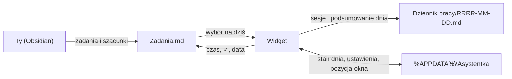
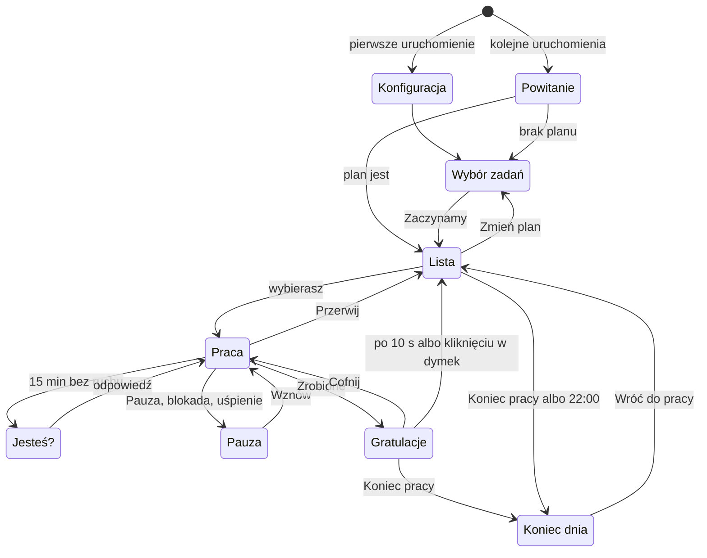

# Asystentka na pulpit — grafiki i specyfikacja v2.1

Oct 29, 2026 · @Paweł

Widget to Sai, postać w prawym dolnym rogu ekranu. Wita Cię po starcie Windows, pomaga wybrać zadania na dziś z pliku w Obsidianie i liczy czas wybranego zadania z możliwością pauzy. Czas zapisuje w pliku zadań i w dzienniku, a na koniec dnia podsumowuje pracę i reaguje na wynik. Widget nie korzysta z LLM ani z internetu: czyta i zapisuje wyłącznie pliki na dysku.

Część A jest dla Ciebie: 12 grafik obowiązkowych i 8 opcjonalnych do wygenerowania w Gemini, z gotowymi promptami. Część B jest dla Claude Code: wyeksportuj dokument do Markdown i zapisz go w folderze projektu jako `SPEC.md`.

Wersja 1 już działa. Zmiany zbierają sekcje „Co zmienia wersja 2.1” i „Co zmienia wersja 2” na początku części B, a głos to osobny, ostatni etap (B10).

## Część A — grafiki do wygenerowania w Gemini

### A1. Zasady dla wszystkich grafik

Każda poza to osobny kwadratowy PNG z tą samą postacią, w tym samym kadrze i skali, na jednolitym zielonym tle. Gemini nie tworzy przezroczystego tła ([forum Google AI](https://discuss.ai.google.dev/t/unable-to-create-transparent-pngs/92868)), więc zieleń usuniemy po wygenerowaniu, jak w [poradniku Phila Schmida](https://www.philschmid.de/generate-stickers).

| Zasada | Wartość |
| --- | --- |
| Format | PNG, kwadrat 1:1, najlepiej 1024 × 1024 px lub więcej |
| Tło | jednolita zieleń `#00FF00`, bez gradientu, cienia i podłogi |
| Kadr | cała postać, wyśrodkowana, ok. 10% marginesu dookoła |
| Linia bazowa | dół postaci (stopy albo miejsce siedzenia) zawsze na tej samej wysokości |
| Kąt | widok 3/4, postać zwrócona lekko w lewo, bo widget stoi w prawym dolnym rogu ekranu; wzorzec i ikona przodem |
| Obrys | cienki biały obrys wokół postaci, jak na naklejce |
| Zakazy | zieleń na postaci, napisy i logo na ubraniu, poświaty i półprzezroczyste efekty |
| Nazwy plików | dokładnie jak w A3, małymi literami, np. `sit_watch.png` |

Skąd te zasady: zieleń na postaci zniknie razem z tłem, a poświaty zamienią się w zielone obwódki, więc neon dodamy w kodzie. Biały obrys ułatwia wycinanie i trzyma postać czytelną na każdej tapecie. Napisy na ubraniu odwróciłyby się, gdy widget odbije postać lustrzanie w lewym rogu ekranu.

### A2. Karta postaci

Proponuję oryginalną bohaterkę w klimacie cyberpunkowej AI-towarzyszki. Przy 200 px wysokości rozpoznawalność dają jej dwie rzeczy: wysoki kucyk z boku i duże słuchawki z anteną. Każdą cechę możesz zmienić, byle zmiana trafiła też do promptu wzorca w A4.

| Cecha | Propozycja |
| --- | --- |
| Imię | do wyboru, np. Bajtka albo Neonka |
| Proporcje | chibi, ok. 2,5 głowy wzrostu |
| Włosy | lawendowe z brzoskwiniowymi końcówkami, wysoki kucyk z boku |
| Oczy | duże, bursztynowe |
| Strój | za duża pastelowożółta kurtka techwear z cienkimi cyjanowymi szwami, granatowe szorty, białe masywne sneakersy |
| Znak rozpoznawczy | duże okrągłe słuchawki z małą anteną zakończoną kulką |
| Charakter | pogodna, trochę zadziorna; kibicuje, zamiast zrzędzić |

Ta paleta dotyczyła odrzuconego wariantu chibi i nie trafia do interfejsu. Kolory interfejsu opisuje B7, a kolory zatwierdzonej postaci A2b.

| Kolor | Hex | Na postaci | W interfejsie (nieaktualne) |
| --- | --- | --- | --- |
| Lawenda | `#B9A6FF` | włosy | ramka panelu |
| Brzoskwinia | `#FFB59A` | końcówki włosów | pasek czasu po przekroczeniu szacunku |
| Żółty | `#FFD84D` | kurtka | przycisk „Zrobione” |
| Cyjan | `#2EDBE8` | szwy, antena | licznik, pasek czasu, poświata |
| Granat | `#1E2140` | szorty | tło panelu |

### A2b. Wariant B: wersja zatwierdzona

Zatwierdzona postać ma ostrą, kanciastą kreskę, czarną twarz w rdzawej masce, duże fioletowe oczy i ogromne kolczaste zielone włosy. Wzorcem jest Twój obraz z Gemini, wycięty z tła jako `ref_master.png` (1612 × 1983 px). Każdą kolejną pozę generuj z nim w załączniku.

Gotowe prompty do każdej pozy, w kolejności generowania, są w zakładce Prompty do Gemini (wariant B).

| Cecha | Opis |
| --- | --- |
| Imię | Sai, po japońsku 才ちゃん (czytanie: さいちゃん); znak 才 znaczy „talent” |
| Kreska | ostre, kanciaste kontury, płaskie kolory, cienki biały obrys naklejki |
| Twarz | matowa czarna; rdzawa maska typu domino z rogami w górnych narożnikach, obejmująca oczy |
| Oczy | duże, fioletowe tęczówki z białymi błyskami, fioletowe rzęsy |
| Usta | otwarty, przyjazny uśmiech z koralowym wnętrzem, bez widocznych zębów |
| Włosy | ogromne, kolczaste, ciemnozielone z jasnymi drobinkami; rosną od linii nad maską, jeden kosmyk opada między oczy |
| Strój | ciemny, kanciasty kombinezon z rdzawymi wstawkami, pończochy w tych samych kolorach |
| Rozmiar w widgecie | 280 px wysokości (B6): twarz ma wtedy ok. 52 px, a cała postać ok. 228 px szerokości |

Wyjątek od A1: zieleń na tej postaci działa, bo jest ciemna i odgradza ją biały obrys. Tło zeszło czysto we wszystkich czterech wersjach, więc obrys jest obowiązkowy w każdej pozie.

**Kolory postaci i ich odpowiedniki w interfejsie**

| Kolor | Hex | Na postaci | W interfejsie (B7) |
| --- | --- | --- | --- |
| Rdza | `#893E25` | maska, wstawki stroju | `--miedz-ciemna`: obwódka dymka; jaśniejsza `--miedz` `#C7773F`: przyciski główne |
| Ciemna zieleń | `#234A39`, refleksy `#41725F` | włosy | `--tlo` `#101B17`, `--tlo-2` `#1A2B24`, `--ramka` `#41725F` |
| Fiolet | `#A778C8` | tęczówki | `--fiolet`: pasek postępu i poświata; `--fiolet-jasny` `#CDB4EE`: cyfry licznika |
| Koral | `#FD8F72` | wnętrze ust | `--koral`: czas ponad szacunek |
| Krem | `#FCF0DF` | kontur postaci | `--tekst` i `--dymek` |
| Granatowa czerń | `#0F0E1C` | twarz | nie trafia do interfejsu |

**Szablon póz dla wariantu B.** Zastępuje szablon z kroku 2 w A4, bo tamten zakazuje zieleni na postaci, a Gemini przemalowałby wtedy włosy.

```text
Use the attached image as the character reference. Draw the SAME character: same face, mask, eyes, hair, outfit, colors, proportions, line art and shading.
New pose: [POSE]
Expression: [EXPRESSION]
Three-quarter view, body turned slightly to the left. Same scale as the reference. Whole body visible, centered, bottom of the character at the same height as in the reference.
Thin white sticker outline. Background: solid flat chroma key green, exactly #00FF00, no gradient, no shadow, no floor.
Keep all of her colors exactly as in the reference, including the dark green hair. No text, no logos, no glow effects. Square image, 1:1.
```

`[POSE]` bierzesz z tabeli w A4, a `[EXPRESSION]` z tej poniżej. W minach unikaj słów „grin” i „teeth”: przy czarnej twarzy wraca wtedy niepokojący uśmiech z zębami.

| Plik | \[EXPRESSION\] |
| --- | --- |
| `stand_idle` | gentle open smile, relaxed eyes |
| `wave_1` | big happy open smile, bright eyes |
| wave\_2 | big happy open smile, bright eyes |
| `point` | cheerful, mouth open as if saying "look!" |
| `sit_watch` | focused, small closed smile |
| `sit_watch_front` | warm open smile, head slightly tilted |
| `sit_console_1` | concentrated, tongue slightly out |
| `sit_console_2` | excited, wide open happy smile |
| `sit_drink` | content, eyes half closed |
| `pause_stretch` | eyes closed, big yawn |
| `pause_nap` | asleep, peaceful, mouth slightly open |
| `idle_check` | curious, one eyebrow raised, small round mouth |
| `cheer_1` | overjoyed, laughing with eyes closed in happy arcs |
| `cheer_2` | playful wink, open smile |
| `bye` | sleepy, half-lidded eyes, soft smile |
| `loading` | thinking, small pout |

Mrugnięcia robisz promptem z kroku 3 w A4. Ikona potrzebuje własnego promptu, bo ta postać nie ma słuchawek:

```text
Use the attached image as the character reference. Draw only her head: the black face, the rust-orange mask, the big violet eyes, the open smile and a few spikes of the dark green hair. Front view, simple shapes and bold outlines that stay readable at 16 x 16 pixels. Thin white sticker outline. Background: solid flat chroma key green, exactly #00FF00. Square image, 1:1.
```

W widgecie wariant B ma 280 px wysokości i delikatniejszy oddech, ze skalą do 1,008. Wartości w B6 i B7 są już pod niego ustawione.

### A3. Lista grafik

Do działającego widgetu wystarczy 12 grafik z pierwszej tabeli, a 8 opcjonalnych dodaje urozmaicenia. Brakującą grafikę opcjonalną widget zastąpi podstawową pozą z tej samej grupy. Status odhaczaj w ostatniej kolumnie.

**Obowiązkowe (12)**

| Plik | Kiedy się pokazuje | Poza i mina | Status |
| --- | --- | --- | --- |
| `ref_master.png` | nigdy: to wzorzec do kolejnych promptów | stoi przodem, neutralnie, lekki uśmiech | Gotowe |
| `stand_idle.png` | lista zadań, czekanie na wybór | stoi, ręce luźno, łagodny uśmiech | Gotowe |
| `stand_idle_blink.png` | mrugnięcie przy liście | jak wyżej, oczy zamknięte | Do zrobienia |
| `wave_1.png` | powitanie po starcie komputera | stoi i macha uniesioną ręką, szeroki uśmiech | Gotowe |
| `sit_watch.png` | licznik działa | siedzi po turecku, patrzy w lewo i w górę, na ekran | Do zrobienia |
| `sit_watch_blink.png` | mrugnięcie przy pracy | jak wyżej, oczy zamknięte | Do zrobienia |
| `sit_console_1.png` | licznik działa, wariant | siedzi po turecku, gra na małej konsolce, skupiona | Do zrobienia |
| `pause_stretch.png` | pauza | siedzi i przeciąga się z rękami nad głową | Do zrobienia |
| `idle_check.png` | pytanie „Jesteś?” po bezczynności | stoi pochylona, dłoń nad oczami, zaciekawiona | Do zrobienia |
| `cheer_1.png` | ukończone zadanie | na palcach, obie ręce w górze, oczy zmrużone z radości | Do zrobienia |
| `bye.png` | koniec dnia | macha na pożegnanie, zaspany uśmiech | Do zrobienia |
| `icon.png` | ikona aplikacji i zasobnika | sama głowa ze słuchawkami, przodem, uśmiech | Do zrobienia |

**Opcjonalne (8)**

| Plik | Kiedy się pokazuje | Poza i mina | Status |
| --- | --- | --- | --- |
| `wave_2.png` | druga klatka machania | ręka przechylona w drugą stronę | Do zrobienia |
| `point.png` | pokazywanie planu | wskazuje palcem w lewo, na listę | Do zrobienia |
| `sit_watch_front.png` | praca, gdy kursor jest blisko widgetu | siedzi po turecku, patrzy na Ciebie, uśmiech | Do zrobienia |
| `sit_console_2.png` | druga klatka konsoli | jak `sit_console_1`, język na wierzchu z emocji | Do zrobienia |
| `sit_drink.png` | licznik działa, wariant | siedzi, pije bubble tea przez słomkę | Do zrobienia |
| `pause_nap.png` | pauza dłuższa niż 15 min | drzemie na siedząco, głowa przechylona | Do zrobienia |
| `cheer_2.png` | druga klatka gratulacji | stoi, pokazuje znak V, puszcza oczko | Do zrobienia |
| `loading.png` | plan dnia jeszcze nie dotarł | stuka palcem w mały unoszący się ekran | Do zrobienia |

Pozy siedzące rysujemy po turecku, na niewidzialnej półce: w widgecie postać siedzi na górnej krawędzi panelu z zadaniem.

### A4. Prompty do Gemini

Pracuj w trzech krokach: najpierw wzorzec, potem pozy z wzorcem w załączniku, na końcu mrugnięcia jako edycja gotowej pozy. Prompty są po angielsku, żeby we wszystkich powtarzały się te same słowa kluczowe. Zmieniasz tylko fragmenty w nawiasach kwadratowych.

**Krok 1. Wzorzec.** Wygeneruj kilka wersji, wybierz najlepszą i zapisz ją jako `ref_master.png`.

```text
Original chibi anime girl, full body, about 2.5 heads tall, standing, front view, neutral pose, gentle smile.
Hair: lavender with peach tips, high side ponytail. Big amber eyes.
Outfit: oversized pastel yellow techwear jacket with thin cyan seams, navy shorts, chunky white sneakers.
Signature accessory: large round headphones with a small antenna ending in a little ball.
Style: clean bold line art, flat cel shading, cute cyberpunk vibe, thin white sticker outline around the character.
Background: solid flat chroma key green, exactly #00FF00, uniform, no gradient, no shadow, no floor.
No green anywhere on the character. No text, no logos, no glow effects.
Character centered, whole body visible with about 10% margin. Square image, 1:1.
```

**Krok 2. Pozy.** W nowej wiadomości dołącz `ref_master.png`, a przy pozach siedzących także gotowy `sit_watch.png`. Wklej szablon i wstaw do nawiasów wartości z tabeli.

```text
Use the attached image as the character reference. Draw the SAME character: same face, hair, outfit, colors, proportions, line art and shading.
New pose: [POSE]
Expression: [EXPRESSION]
Three-quarter view, body turned slightly to the left. Same scale as the reference. Whole body visible, centered, bottom of the character at the same height as in the reference.
Thin white sticker outline. Background: solid flat chroma key green, exactly #00FF00, no gradient, no shadow, no floor.
No green on the character, no text, no logos, no glow effects. Square image, 1:1.
```

| Plik | \[POSE\] | \[EXPRESSION\] |
| --- | --- | --- |
| `stand_idle` | standing relaxed, arms loose at her sides | soft smile |
| `wave_1` | standing, waving with one hand raised high | big happy smile |
| `wave_2` | standing, waving, the raised hand tilted to the other side | big happy smile |
| `point` | standing, pointing with her index finger to the left side of the image | cheerful, mouth slightly open |
| `sit_watch` | sitting cross-legged on an invisible flat ledge, hands on her knees, looking up and to the left | focused, slight smile |
| `sit_watch_front` | sitting cross-legged on an invisible flat ledge, looking straight at the viewer | warm smile |
| `sit_console_1` | sitting cross-legged on an invisible flat ledge, holding a small handheld game console in both hands, looking down at it | concentrated |
| `sit_console_2` | sitting cross-legged on an invisible flat ledge, holding a small handheld game console, leaning slightly forward | excited, tongue slightly out |
| `sit_drink` | sitting cross-legged on an invisible flat ledge, sipping bubble tea through a straw, cup held in both hands | content, eyes half closed |
| `pause_stretch` | sitting cross-legged on an invisible flat ledge, stretching both arms above her head | relaxed, eyes closed |
| `pause_nap` | sitting cross-legged on an invisible flat ledge, dozing off, head tilted to one side | asleep, peaceful |
| `idle_check` | standing, leaning forward, one hand above her eyes as if looking for someone | curious, puzzled |
| `cheer_1` | standing on tiptoes, both arms raised high in celebration | overjoyed, eyes closed in happy arcs |
| `cheer_2` | standing, making a peace sign with one hand | winking, big grin |
| `bye` | standing, waving goodbye with one hand | sleepy smile, eyes half closed |
| `loading` | standing, tapping a small floating rectangular screen in front of her with one finger | thinking, slightly puzzled |

**Krok 3. Mrugnięcia.** Dołącz gotową pozę (`stand_idle.png` albo `sit_watch.png`) i wpisz:

```text
Edit the attached image: close her eyes as in a natural blink, drawn as two soft curved lines. Change nothing else: same pose, outfit, colors, outline, framing and green background.
```

**Ikona.** Dołącz `ref_master.png` i wpisz:

```text
Use the attached image as the character reference. Draw only her head with the headphones, front view, simple shapes and bold outlines that stay readable at 16 x 16 pixels, cheerful smile. Thin white sticker outline. Background: solid flat chroma key green, exactly #00FF00. Square image, 1:1.
```

**Gdy coś idzie nie tak**

- Gemini zmienia proporcje obrazu: dołącz jako ostatnią pustą kwadratową kanwę i napisz, że to układ do użycia ([opis obejścia](https://workalizer.com/blog/apps-tools/mastering-geminis-image-aspect-ratios-tips-for-google-workspace-creators)). Plik `kanwa_1x1.png` dostaniesz ode mnie w czacie.
- Postać dryfuje (inna twarz albo kolory): zacznij nowy czat i dołącz wzorzec oraz najbliższą udaną pozę.
- Na tle pojawia się cień albo gradient: dopisz na końcu promptu „flat background, absolutely no shading on the background”.
- Generuj po 2–4 wersje każdej pozy i zacznij od wszystkich obowiązkowych.

### A5. Co zrobić z gotowymi plikami

Wrzuć mi gotowe PNG w czacie, a przygotuję z nich paczkę `postac/` do projektu.

1. Usunę zielone tło kluczowaniem koloru, jak w [poradniku Phila Schmida](https://www.philschmid.de/generate-stickers), i oczyszczę krawędzie.
2. Wyrównam skalę i linię bazową, żeby pozy nie skakały przy podmianie.
3. Jeśli przy mrugnięciu Gemini przesunie coś poza oczami, wkleję same oczy do oryginalnej pozy.
4. Z `icon.png` Tauri zrobi wszystkie rozmiary ikon dla Windows jedną komendą `tauri icon`.
5. Odeślę gotowy folder do wrzucenia w `src/assets/postac/`.

## Część B — specyfikacja v2.1 (dla Claude Code)

### Co zmienia wersja 2.1

Wersja 2.1 to poprawki i dodatki po pierwszych testach. Wdrażaj je po zmianach z wersji 2; wszystko, czego lista nie wymienia, zostaje bez zmian.

1. **Wiele monitorów** (B6): widget można przenieść na dowolny monitor i tam zostaje, także po zmianie stanu, rozmiaru panelu i po restarcie. Pozycja, kierunek rozwijania panelu, odbicie lustrzane i chowanie przy pełnym ekranie liczą się względem monitora, na którym stoi widget.
2. **Sekwencja przerwy i konsolka** (B4, B7): po wciśnięciu Pauzy postać przez 5 s się przeciąga, potem gra na konsolce, a po 15 min przerwy zasypia. Na konsolce `sit_console_1` jest pozą stałą, a `sit_console_2` pojawia się tylko na 3 s co 2 min, także w Pracy. Nowa kwestia `pauza_gra` w `kwestie.json`.
3. **Skrót klawiszowy** (B6): Ctrl+Alt+Spacja zajmuje szybkie okno aplikacji Claude, więc nowy domyślny skrót to Ctrl+Alt+Shift+Spacja. Widget sprawdza, czy skrót się zarejestrował, i mówi o konflikcie, a w ustawieniach skrót ustawia się przez naciśnięcie klawiszy.
4. **Zrobione od razu w pliku** (B3, B5): ptaszek, data i czas trafiają do `Zadania.md` w chwili kliknięcia Zrobione, zanim pokaże się dymek. Teraz ptaszek nie pojawia się od razu, więc najpierw znaleźć przyczynę. Dymek gratulacji ma przez 10 s przycisk Cofnij.
5. **Imię postaci** (A2b, B6, B7): postać nazywa się Sai. Imię siedzi w ustawieniach (`nazwa_postaci`) i zastępuje słowo „asystentka” wszędzie, gdzie widać je w interfejsie: w kreatorze, w dymkach (`{postac}`), w menu („Zamknij Sai”), w podpowiedzi ikony w zasobniku i w tytule okienka ustawień. Nazwa programu w Windows, `identifier` i folder `%APPDATA%\Asystentka\` zostają bez zmian, żeby nie zgubić ustawień ani wpisu autostartu.
6. **Kolory interfejsu** (B7): zieleń, miedź i fiolet z palety postaci zamiast granatów i błękitów. Stara paleta z A2 pochodziła z odrzuconego wariantu chibi i znika z kodu.
7. **Dźwięk skupienia** (B7): w czasie pracy gra zapętlone dudnienie 40 Hz z pliku `src/assets/dzwiek/skupienie_40hz.wav`, z przełącznikiem w menu i znacznikiem w dzienniku.
8. **Głos** (B10): opis na później. Nie wdrażaj, dopóki w projekcie nie pojawią się pliki w `src/assets/glos/`.

### Co zmienia wersja 2

Wersja 2 odcina widget od porannego zadania i Dysku Google: zadania wybierasz sam z pliku w Obsidianie, a widget dopisuje do nich czas. Wdrażaj zmiany w tej kolejności; wszystko, czego lista nie wymienia, zostaje jak w wersji 1.

1. **Kreator przy pierwszym uruchomieniu i okienko ustawień** (B4, B6, B7): forma zwracania się, plik zadań (nowy z szablonu albo istniejący), folder dziennika, dzienny cel i autostart. Te same pola są potem do zmiany w okienku ustawień, a nie w pliku JSON.
2. **Plik zadań w Markdown** (B2, B3): widget czyta zadania z `Zadania.md` i dopisuje do nich czas, ptaszka i datę ukończenia.
3. **Wybór zadań raz dziennie** (B4): stan „Wybór zadań” zastępuje „Czeka na plan”. Ma podpowiedź, sumę szacunków i ostrzeżenie po przekroczeniu celu. W ciągu dnia można zmienić plan i dopisać zadanie.
4. **Podsumowanie po zadaniu** (B4): czas zadania względem szacunku, czas całego dnia i to, co jeszcze zostało.
5. **Koniec pracy na dziś** (B4, B7): przycisk, podsumowanie dnia i reakcja zależna od wykonania planu i przepracowanego czasu. Dzień zamyka się sam o 22:00.
6. **Menu pod prawym przyciskiem i „Zamknij asystentkę”** (B6): zamknięcie zapisuje trwającą sesję.
7. **Usunięcie zależności z wersji 1** (B2, B8): pliki `plan-RRRR-MM-DD.json` i `stan-zadan.json`, folder na Dysku Google i stan „Czeka na plan” nie są już potrzebne.
8. **Nowa grafika `concerned.png`** do reakcji „zmartwiona”. Plik jest już w paczce postac/ i zastępuje tymczasowy `stand_idle.png`.

### B1. Cel i zakres v2

v2 to lokalny widget na Windows 10 (wersja 2004 lub nowsza) i 11. Pomaga wybrać zadania z pliku w Obsidianie, liczy czas z pauzą, zapisuje go w pliku zadań i w dzienniku, a na koniec dnia podsumowuje pracę. Widget nie łączy się z internetem i zmienia tylko plik zadań, dziennik i własne pliki w `%APPDATA%\Asystentka`.

**W zakresie v2**

- kreator przy pierwszym uruchomieniu i okienko ustawień;
- autostart z Windows, powitanie i wybór zadań na dziś raz dziennie;
- zmiana planu i szybkie dopisanie zadania w ciągu dnia;
- licznik czasu na wybranym zadaniu, pauza ręczna i automatyczna (blokada ekranu, uśpienie);
- podsumowanie po każdym zadaniu oraz zapis do pliku zadań i dziennika;
- koniec pracy na dziś z podsumowaniem i reakcją, ręcznie albo automatycznie o ustalonej godzinie;
- menu pod prawym przyciskiem i w zasobniku, z zamknięciem asystentki;
- praca na dowolnym monitorze, z zapamiętaną pozycją;
- imię postaci w interfejsie i kolory z jej palety;
- dźwięk skupienia 40 Hz w czasie pracy;
- chowanie się przy pełnym ekranie na tym samym monitorze i ukrywanie przed nagrywaniem ekranu;
- grafiki z części A i animacje w kodzie.

**Poza zakresem v2:** LLM i czat, WOOP, efekty dźwiękowe poza dźwiękiem skupienia (B7), statystyki tygodniowe, zależności między zadaniami, kilka plików zadań naraz. Głos to osobny, ostatni etap (B10). Rzeczy na później zbiera B9.

### B2. Przepływ danych i przygotowanie

Jedynym źródłem zadań jest plik `Zadania.md` w Twoim vaulcie Obsidiana. Ty dopisujesz w nim zadania, a widget wczytuje je przy wyborze planu i dopisuje do nich czas. Przebieg pracy trafia do dziennika w tym samym vaulcie.



Widget nie potrzebuje internetu, Dysku Google ani porannego zadania: wszystkie pliki leżą na Twoim komputerze.

**Przygotowanie (raz)**

1. Zainstaluj Obsidiana i utwórz vault, np. `Second Brain`. Obsidian nie jest konieczny: plik zadań to zwykły tekst, który otworzy każdy edytor.
2. Uruchom widget. Kreator zapyta, jak ma się do Ciebie zwracać, i utworzy `Zadania.md` z przykładami w wybranym folderze albo pozwoli wskazać istniejący plik.
3. Dopisz zadania w pliku. Widget zauważy zapis i sam odświeży listę.

Folder vaulta widget podpowiada na podstawie listy vaultów w `%APPDATA%\Obsidian\obsidian.json` (klucz `vaults`, w każdym wpisie `path`). Plik z vaulta otwiera w Obsidianie adresem `obsidian://open?path=` z zakodowaną ścieżką pliku ([pomoc Obsidiana](https://obsidian.md/help/uri)). Gdy to się nie uda, otwiera plik w domyślnym edytorze.

### B3. Formaty plików

Widget pracuje na dwóch plikach w vaulcie i dwóch własnych w `%APPDATA%\Asystentka`. Każdy plik ma jasno określone, kto co w nim zmienia.

| Plik | Gdzie | Pisze | Czyta |
| --- | --- | --- | --- |
| `Zadania.md` | wybrany w kreatorze, np. główny folder vaulta | Ty (zadania i szacunki), widget (czas, ptaszek, data) | widget, Ty |
| `RRRR-MM-DD.md` | `Dziennik pracy/` w vaulcie | widget | Ty |
| `dzien.json` | `%APPDATA%\Asystentka\` | widget | widget |
| `ustawienia.json` | `%APPDATA%\Asystentka\` | widget (okienko ustawień) | widget |
| `okno.json` | `%APPDATA%\Asystentka\` | widget (pozycja okna, B6) | widget |

**Plik zadań**

```markdown
# Zadania

## Film #1 · FIFA
- [ ] Montaż: plansze 1–5 [szac:: 120] [czas:: 45] [termin:: 2026-11-05]
- [ ] Miniatura [szac:: 30]
- [x] Scenariusz: intro [szac:: 60] [czas:: 47] ✅ 2026-10-29

## Inbox
- [ ] Odpisać na maila od montażysty [szac:: 15]
```

- Nagłówek `##` to projekt. Zadania przed pierwszym nagłówkiem należą do projektu „Bez projektu”.
- Zadanie to linia `- [ ]` (otwarte) albo `- [x]` (zrobione). Wcięte podzadania są zwykłymi zadaniami tego samego projektu.
- `[szac:: minuty]` wpisujesz Ty. `[czas:: minuty]` to łączny czas ze wszystkich dni i dopisuje go widget. `[termin:: RRRR-MM-DD]` jest opcjonalny i służy tylko do kolejności podpowiedzi.
- Przy ukończeniu widget zmienia `[ ]` na `[x]` i dopisuje `✅ RRRR-MM-DD`, w formacie zgodnym z wtyczką Tasks. Robi to w chwili kliknięcia Zrobione (B5), a nie na koniec dnia.
- „W toku” to otwarte zadanie z `czas` większym od zera, bez osobnego statusu.
- Zadanie bez `szac` liczy się w sumie jako 0 i ma na liście znaczek „bez szacunku”.
- Zadanie rozpoznaje para: projekt i tekst linii bez pól. Jeśli widget go nie znajdzie, bo zmieniłeś tekst, zapisuje sesję tylko w dzienniku i mówi o tym w dymku.
- Zapis: tuż przed zapisem wczytaj plik od nowa, zmień tylko jedną linię i zapisz przez plik tymczasowy z zamianą nazwy. Reszta pliku, łącznie z końcami linii i kodowaniem UTF-8, zostaje bez zmian.
- Widget obserwuje plik i odświeża listę po każdym zapisie, także z Obsidiana.

**Szablon** tworzony przez kreator (termin przykładu: dziś + 14 dni):

```markdown
# Zadania

<!-- Jak pisać zadania dla {postac}:
- jedna linia to jedno zadanie: - [ ] Nazwa [szac:: minuty]
- nagłówek ## grupuje zadania w projekt
- opcjonalnie termin: [termin:: RRRR-MM-DD]
- [czas:: …] i ✅ dopisuje {postac} -->

## Przykładowy projekt
- [ ] Pierwsze zadanie [szac:: 30]
- [ ] Drugie zadanie [szac:: 60] [termin:: 2026-11-12]

## Inbox
```

**Dziennik**

```markdown
---
data: 2026-10-30
minuty: 132
cel_min: 240
zaplanowane: 4
zrobione: 2
---
<!-- widget:start -->
## Praca · 30.10.2026

- [x] 09:12–10:05 · Scenariusz: intro · 47 min (szac. 60) · Film #1 · FIFA · 40 Hz
- [ ] 10:20–11:05 · Montaż: plansze 1–5 · 45 min · w toku · Film #1 · FIFA
- [x] 11:30–12:10 · Miniatura · 40 min (szac. 30) · Film #1 · FIFA

**Razem:** 2 h 12 min z celu 4 h · **Plan:** 2 z 4 zadań

### Podsumowanie dnia
Reakcja: lekko pochwalająca
Na jutro: Montaż: plansze 1–5, Odpisać na maila od montażysty
<!-- widget:end -->
```

- Jedna notatka na dzień i jedna linia na sesję. Godziny to start i koniec sesji, minuty to czas bez pauz. Znacznik „· 40 Hz” na końcu linii znaczy, że przez większość sesji grał dźwięk skupienia (B7).
- Sekcję „Podsumowanie dnia” widget dopisuje przy końcu pracy. Gdy wrócisz do pracy tego samego dnia, usuwa ją i wpisuje od nowa przy kolejnym zamknięciu.
- Widget zmienia tylko swoje pola we frontmatterze i blok między znacznikami `widget:start` i `widget:end`. Twoje notatki poza blokiem zostają nietknięte.

**Stan dnia** w `dzien.json`, żeby restart komputera niczego nie gubił:

```json
{
  "data": "2026-10-30",
  "plan": [
    {"projekt": "Film #1 · FIFA", "zadanie": "Montaż: plansze 1–5"},
    {"projekt": "Film #1 · FIFA", "zadanie": "Miniatura"}
  ],
  "sesja": {
    "projekt": "Film #1 · FIFA",
    "zadanie": "Montaż: plansze 1–5",
    "odcinki": [["2026-10-30T10:20:00+01:00", "2026-10-30T10:41:00+01:00"]],
    "pauza": false
  },
  "zamkniety": false
}
```

- Zapis co 30 s i przy każdej zmianie. Po restarcie widget wznawia plan, a trwającą sesję przywraca zapauzowaną.
- Inna data niż dzisiejsza oznacza nowy dzień. Jeśli poprzedni dzień nie został zamknięty, widget zamyka go sam i pokazuje jego podsumowanie przed wyborem zadań.

### B4. Stany postaci i przejścia

Postać ma dziesięć stanów i w każdej chwili jest w dokładnie jednym; każdy stan ma swoje grafiki, panel i dymek.



Ukryta nakłada się na każdy inny stan przy pełnym ekranie, dlatego nie ma jej na rysunku. „Wróć do pracy” z końca dnia prowadzi z powrotem do Listy.

| Stan | Grafiki | Panel | Przykładowy dymek |
| --- | --- | --- | --- |
| Konfiguracja | `wave_1`, `point` | kreator w pięciu krokach: forma zwracania się, plik zadań, folder dziennika, cel dzienny, autostart | „Cześć! Jestem {postac}, Twoja asystentka. Jak mam się do Ciebie zwracać?” |
| Powitanie | `wave_1`, `wave_2` | wejście z efektem glitch, sam dymek | „Dzień dobry, {imie}!” |
| Wybór zadań | `point`, `stand_idle` z mrugnięciem | otwarte zadania pogrupowane w projekty, pola wyboru, suma szacunków względem celu, przycisk „Zaczynamy” | „Co bierzemy na dziś?” |
| Lista | `stand_idle` z mrugnięciem | wybrane zadania z szacunkiem, zrobione wyszarzone, przyciski „Zmień plan” i „Dodaj zadanie” | „Od czego zaczynamy?” |
| Praca | `sit_watch` z mrugnięciem, `sit_watch_front`, `sit_console_1`, `sit_console_2`, `sit_drink` | mini-panel: nazwa, licznik, szacunek, etykieta „♪ 40 Hz”, przyciski Pauza, Zrobione, Przerwij | „Pilnuję czasu. Działaj!” |
| Pauza | `pause_stretch` przez 5 s, potem `sit_console_1` i `sit_console_2`, od 15 min przerwy `pause_nap` (B7) | licznik stoi, czas pauzy, przycisk Wznów | „Przerwa? Jasne, czekam.”, po 5 s „To ja w tym czasie pogram!” |
| Jesteś? | `idle_check` | przyciski Przerwa (odejmij X min) i Pracowałem | „Halo? Przerwa czy praca?” |
| Gratulacje | `cheer_1`, `cheer_2`, konfetti w kodzie | podsumowanie zadania w dymku z przyciskiem Cofnij przez 10 s; po ostatnim zadaniu planu przyciski „Koniec pracy” i „Dodaj z listy” | „Brawo! Miniatura: 40 min (szac. 30). Dziś razem 2 h 12 min.” |
| Koniec dnia | wg tabeli reakcji, potem `bye`; po schowaniu `pause_nap` | podsumowanie dnia, przyciski „Do jutra” i „Wróć do pracy”; potem okno chowa się do zasobnika | wg tabeli reakcji |
| Ukryta | brak | okno schowane, licznik działa dalej | brak |

- Pełne powitanie tylko przy pierwszym starcie dnia; kolejne starty tego dnia idą prosto do Listy z dymkiem „O, wróciłeś!”.
- W Wyborze zadań zadania w toku i niedokończone z poprzedniego planu są zaznaczone z góry. Dalej lista idzie według terminu, a potem według kolejności w pliku.
- Suma liczy pozostały czas: szacunek minus czas już przepracowany, co najmniej 10 min na zadanie. Gdy przekracza cel o ponad 20%, pole sumy robi się koralowe, a postać mówi „To sporo jak na jeden dzień. Na pewno?”.
- „Dodaj zadanie” ma pola: nazwa, szacunek i projekt (nagłówek z pliku albo Inbox). Widget dopisuje linię pod wybranym nagłówkiem i od razu dodaje zadanie do dzisiejszego planu.
- W Pracy jest zawsze jedno zadanie: zmiana zadania wymaga Przerwij albo Zrobione.
- „Koniec pracy na dziś” jest w każdym stanie w menu pod prawym przyciskiem i w zasobniku (B6). Trwająca sesja zapisuje się wtedy jak przy Przerwij.
- O godzinie zamknięcia dnia (domyślnie 22:00) widget kończy dzień sam. Jeśli komputer był wtedy wyłączony, robi to przy następnym uruchomieniu.
- „Wróć do pracy” otwiera ten sam dzień od nowa: usuwa podsumowanie z dziennika i wraca do Listy.
- Ukryta nakłada się na każdy inny stan: gdy znika powód ukrycia, wraca poprzedni stan.

**Reakcje na koniec dnia.** Plan jest wykonany, gdy wszystkie zadania z dzisiejszego planu, łącznie z dopisanymi w ciągu dnia, mają ptaszka. Progi czasu liczy się od celu z ustawień (domyślnie 240 min).

| Przepracowany czas | Plan | Reakcja | Grafika | Dymek |
| --- | --- | --- | --- | --- |
| cel lub więcej | wykonany | zachwycona | `cheer_1` i `cheer_2` na zmianę, konfetti 3 s | „Wszystko zrobione i {czas\_dnia} pracy! Jestem zachwycona!” |
| cel lub więcej | niewykonany | zadowolona | `cheer_2` | „{czas\_dnia} pracy, szacun! Plan był chyba trochę za duży, resztę dokończymy jutro.” |
| od 1 h do celu | wykonany | dumna | `cheer_1`, konfetti 1,5 s | „Plan wykonany! Jestem z Ciebie dumna.” |
| od 1 h do celu | niewykonany | lekko pochwalająca | `stand_idle` | „{czas\_dnia} to dobra robota. Resztę bierzemy jutro.” |
| poniżej 1 h | wykonany | czuła | `cheer_2` | „Miłego dnia, wróć jutro :\*” |
| poniżej 1 h | niewykonany | zmartwiona, ale wspierająca | `concerned` | „Jutro będzie lepiej. Dopóki walczysz, jesteś zwycięzcą :3” |

- Panel podsumowania pokazuje: zrobione z zaplanowanych, czas dnia względem celu, czas każdego zadania względem szacunku i listę na jutro, czyli niezrobione zadania z planu.
- Po reakcji postać macha (`bye`) z dymkiem „Do jutra!” i chowa się do zasobnika. To samo podsumowanie trafia do dziennika (B3).

### B5. Licznik czasu, pauza i zdarzenia systemowe

Licznik liczy tylko czas aktywnej pracy, czyli odcinki od startu albo wznowienia do pauzy albo końca sesji.

- **Sesja:** jedno zadanie i lista odcinków (początek, koniec). Naraz trwa najwyżej jedna sesja.
- **Wyświetlanie:** `mm:ss`, od godziny `h:mm:ss`, a obok szacunek, np. „47 / 60 min”. Przy zadaniu w toku licznik pokazuje łączny czas: zapisany w pliku plus bieżącą sesję. Po przekroczeniu szacunku pasek czasu robi się koralowy, bez komunikatów o winie.
- **Pauza ręczna:** przycisk w panelu, menu pod prawym przyciskiem i menu zasobnika.
- **Pauza automatyczna:** blokada ekranu i uśpienie komputera. Po powrocie pauza zostaje, a postać pyta „Wracamy?” z przyciskiem Wznów.
- **Bezczynność:** 15 min bez myszy i klawiatury w stanie Praca (wartość z ustawień) włącza stan Jesteś?. „Przerwa” odejmuje czas od ostatniej aktywności, „Pracowałem” go zostawia. Gdy na którymkolwiek monitorze trwa pełny ekran, nie pyta, bo wtedy możesz oglądać materiał albo grać.
- **Przypomnienie o przerwie:** po 50 min ciągłej pracy postać się przeciąga i pokazuje mały dymek, bez dźwięku. Wartość 0 w ustawieniach je wyłącza.
- **Koniec sesji:** Zrobione od razu, zanim pokaże się dymek, zapisuje w pliku zadań łączny czas, ptaszka i datę, a w dzienniku linię sesji. Zapis nie czeka na koniec dnia ani na zamknięcie dymku. Potem włącza Gratulacje z podsumowaniem i przyciskiem Cofnij, widocznym przez 10 s; po tym czasie albo po kliknięciu w dymek widget przechodzi do Listy. Cofnij zdejmuje ptaszka i datę w pliku zadań, w linii sesji w dzienniku zmienia `[x]` na `[ ]` i zaczyna nową sesję tego samego zadania z dymkiem `cofniete`; zapisany czas zostaje. Przerwij zapisuje sesję w dzienniku i łączny czas w pliku, bez ptaszka, i wraca do Listy.
- **Koniec pracy i zamknięcie:** „Koniec pracy na dziś” i „Zamknij {postac}” przy działającym liczniku najpierw kończą sesję jak Przerwij.
- **Trwałość:** stan dnia i sesji w `dzien.json` (B3), zapisywany co 30 s i przy każdej zmianie. Po awarii albo wyłączeniu komputera sesja wraca zapauzowana, z czasem policzonym do ostatniego zapisu.
- **Północ:** sesja, która przechodzi przez północ, należy do dnia, w którym się zaczęła.

**Jak wykryć zdarzenia w Windows** (Rust, crate `windows`; równoważne rozwiązania są w porządku)

| Zdarzenie | Mechanizm Windows | Sprawdzanie |
| --- | --- | --- |
| Blokada i odblokowanie ekranu | `WTSRegisterSessionNotification` → `WM_WTSSESSION_CHANGE` z `WTS_SESSION_LOCK` / `WTS_SESSION_UNLOCK` | zdarzenie |
| Uśpienie i wybudzenie | `WM_POWERBROADCAST` z `PBT_APMSUSPEND` / `PBT_APMRESUMEAUTOMATIC` | zdarzenie |
| Bezczynność | `GetLastInputInfo` | co 30 s |
| Pełny ekran | okno na pierwszym planie (`GetForegroundWindow`) zajmuje cały swój monitor (`MonitorFromWindow`, `GetMonitorInfoW`), z pominięciem pulpitu; chowa się tylko wtedy, gdy to monitor widgetu. Dodatkowy sygnał: `SHQueryUserNotificationState` (`QUNS_BUSY`, `QUNS_RUNNING_D3D_FULL_SCREEN`, `QUNS_PRESENTATION_MODE`) | co 2 s |

### B6. Okno i integracja z Windows

Widget to jedno małe okno bez ramki w prawym dolnym rogu, które nie przeszkadza w grach, nagraniach i pracy.

- **Okno:** bez ramki, przezroczyste tło, zawsze na wierzchu, bez przycisku na pasku zadań; ikona w zasobniku.
- **Wiele monitorów:** widget może stać na dowolnym monitorze. Jego monitor to ten, na którym leży środek okna. Pozycję, rozmiar i przycinanie okna liczy się zawsze względem obszaru roboczego tego monitora, nigdy monitora głównego. W Tauri służą do tego `currentMonitor()`, `monitorFromPoint()` i `availableMonitors()` oraz obszar roboczy monitora (`Monitor::work_area` w Rust).
- **Pozycja i kotwica:** domyślnie prawy dolny róg obszaru roboczego monitora głównego, 16 px od krawędzi. Po przeciągnięciu widget zapamiętuje swój monitor, najbliższy róg jego obszaru roboczego (kotwicę) i odstępy od tego rogu. Przy każdej zmianie stanu i rozmiaru panelu kotwica zostaje na miejscu, a okno nie wychodzi poza obszar roboczy swojego monitora.
- **Kierunek rozwijania:** panel rośnie od kotwicy w stronę środka monitora: przy dolnej krawędzi w górę, przy górnej w dół. Postać odbija się lustrzanie, gdy widget stoi na lewej połowie swojego monitora, żeby dalej patrzyła w stronę środka ekranu.
- **Rozmiar:** postać ma 280 px wysokości, panel 280 px szerokości, a panel wyboru zadań do 360 px szerokości i do 60% wysokości monitora, z przewijaniem. Okno nie ma dużych przezroczystych obszarów, które blokowałyby kliknięcia.
- **Różne skalowanie monitorów:** rozmiary są w pikselach logicznych, więc na monitorze ze skalowaniem 150% postać wygląda tak samo jak na 100%. Po przejściu na monitor z innym skalowaniem okno od razu przelicza rozmiar, bez skoku pozycji.
- **Zapis pozycji:** `okno.json` przechowuje nazwę, położenie i rozmiar monitora, kotwicę (`prawy-dolny`, `lewy-dolny`, `prawy-gorny`, `lewy-gorny`) i odstępy w pikselach logicznych. Przy starcie widget szuka monitora o tej nazwie, potem o tym samym położeniu i rozmiarze. Gdy go nie ma, na przykład po odłączeniu, staje w domyślnym miejscu na monitorze głównym. To samo dzieje się, gdy monitor widgetu zniknie w trakcie pracy.
- **Menu pod prawym przyciskiem** na postaci i panelu: Koniec pracy na dziś · Zmień plan · Dodaj zadanie · Pauza / Wznów · Ukryj · Przywróć pozycję · Dźwięk 40 Hz · Ustawienia · Zamknij {postac}. Na Windows 11 ikona zasobnika domyślnie trafia pod strzałkę „^”, dlatego wszystkie polecenia są też tutaj.
- **Menu zasobnika:** Pokaż / Ukryj · Pauza / Wznów · Koniec pracy na dziś · Przywróć pozycję · Ukryj przed nagrywaniem (domyślnie zaznaczone) · Dźwięk 40 Hz · Ustawienia · Zamknij {postac}. Podpowiedź ikony to imię postaci. Lewy klik w ikonę pokazuje i chowa widget. „Przywróć pozycję” stawia widget w domyślnym miejscu na monitorze głównym, gdyby się zgubił.
- **Zamknij {postac}:** kończy trwającą sesję jak Przerwij, zapisuje `dzien.json` i kończy proces. Dzień zostaje otwarty, więc kolejne uruchomienie tego samego dnia wraca do Listy.
- **Okienko ustawień:** zwykłe okno „{postac} · ustawienia” z polami z kreatora i pozostałymi ustawieniami z B7, z przyciskami Zapisz i Anuluj. Zmiany działają od razu, bez restartu.
- **Autostart i jedna instancja:** start po zalogowaniu do Windows, do wyłączenia w ustawieniach; drugie uruchomienie tylko pokazuje istniejące okno.
- **Skrót globalny:** Ctrl+Alt+Shift+Spacja pokazuje i chowa widget. Ctrl+Alt+Spacja odpada, bo u Ciebie otwiera szybkie okno aplikacji Claude. Gdy rejestracja skrótu się nie uda, widget raz pokazuje dymek `skrot_zajety` i działa dalej bez skrótu. W okienku ustawień pole skrótu nagrywa naciśniętą kombinację, od razu sprawdza, czy da się ją zarejestrować, i odrzuca Ctrl+Alt z literą: na polskiej klawiaturze to AltGr, więc taki skrót blokowałby pisanie ą, ć, ę, ł, ń, ó, ś, ź i ż. Stary domyślny `Ctrl+Alt+Space` w `ustawienia.json` widget przy pierwszym starcie wersji 2.1 zamienia na nowy.
- **Pełny ekran:** widget chowa się tylko wtedy, gdy aplikacja pełnoekranowa działa na jego monitorze. Gra na pełnym ekranie na jednym monitorze nie chowa widgetu stojącego na drugim. Licznik liczy dalej, a po wyjściu z pełnego ekranu okno wraca. Sposób wykrywania opisuje tabela w B5.
- **Ukrycie przed nagrywaniem:** `SetWindowDisplayAffinity(hwnd, WDA_EXCLUDEFROMCAPTURE)` wyklucza okno z przechwytywania ekranu w Windows 10 2004 i nowszych. Widzisz widget na monitorze, ale nie ma go w OBS ani na udostępnianym ekranie; sprawdzić w testach z OBS (Display Capture), także na drugim monitorze. Wyłączenie opcji pozwala nagrać postać, np. do filmu o widgecie.
- **Wydajność:** animacje tylko w CSS (`transform`, `opacity`), bez stałej pętli JavaScript. Stan systemu sprawdzany co 2–30 s, a plik zadań przez powiadomienia systemu plików, bez ciągłego odpytywania. W czasie gry widget nie obciąża zauważalnie procesora.

### B7. Animacje w kodzie, kolory, dymki, ustawienia i dźwięk

Grafiki są statyczne, a życia dodają im proste animacje CSS, losowane dymki i ustawienia w jednym pliku JSON.

**Animacje**

| Efekt | Jak |
| --- | --- |
| Oddech | skala w pionie 1,000–1,008, cykl 3,5 s, punkt zaczepienia u dołu postaci |
| Mrugnięcie | podmiana na `*_blink` na 130 ms, losowo co 3–7 s |
| Wejście i wyjście | glitch: przesunięte kanały RGB i poszarpane paski, 400 ms |
| Zmiana pozy w Pracy | losowo co 3–6 min spośród dostępnych póz siedzących, przejście przez zanikanie 150 ms; obie pozy z konsolką liczą się jako jedna |
| Konsolka | `sit_console_1` to poza stała. `sit_console_2` pojawia się na 3 s co 2 min, w Pracy i w przerwie, z przejściem przez zanikanie 150 ms. Poza tym rusza się tylko oddech |
| Sekwencja przerwy | 0–5 s: `pause_stretch` z jednym mocniejszym przeciągnięciem (skala w pionie do 1,03 i z powrotem w 1,2 s); od 5 s: konsolka jak wyżej; od 15 min przerwy: `pause_nap`. Przejścia przez zanikanie 150 ms. Pozę liczy się z czasu od początku przerwy, więc po powrocie z blokady ekranu albo uśpienia od razu widać właściwą. |
| Spojrzenie | `sit_watch_front`, gdy kursor jest bliżej niż 300 px od widgetu, w przeciwnym razie `sit_watch`; sprawdzane co 500 ms |
| Gratulacje | dwa podskoki po 12 px i konfetti w kolorach palety przez 1,5 s; na koniec dnia według tabeli reakcji (B4) |
| Czytelność | jasny obrys i delikatna fioletowa poświata przez `filter: drop-shadow` |
| Brak grafiki opcjonalnej | podstawowa poza z tej samej grupy |

**Kolory interfejsu** pochodzą z palety postaci: zieleni włosów, miedzi maski, fioletu oczu i kremowego konturu. Zastępują granaty, cyjan, lawendę i żółć z palety odrzuconego wariantu chibi (A2), których interfejs nie używa nigdzie. Wszystkie kolory są zmiennymi CSS w jednym miejscu, a komponenty nie mają kolorów wpisanych na sztywno.

```css
:root {
  --tlo: #101B17;
  --tlo-2: #1A2B24;
  --ramka: #41725F;
  --tekst: #FCF0DF;
  --tekst-2: #B3C2B8;
  --miedz: #C7773F;
  --miedz-ciemna: #893E25;
  --fiolet: #A778C8;
  --fiolet-jasny: #CDB4EE;
  --zielen: #7CC49E;
  --koral: #FD8F72;
  --dymek: #FCF0DF;
  --dymek-tekst: #101B17;
}
```

| Element | Kolory |
| --- | --- |
| Panele, okienko ustawień, kreator | tło `--tlo`, ramka 1,5 px `--ramka`, tekst `--tekst`, opisy i godziny `--tekst-2` |
| Lista zadań | bieżące zadanie na `--tlo-2`; zrobione: ptaszek `--zielen`, nazwa przekreślona w `--tekst-2` |
| Licznik i paski | cyfry `--fiolet-jasny`, pasek `--fiolet` na torze `--tlo-2`, po przekroczeniu szacunku `--koral`; za duży plan też `--koral` |
| Przyciski | główny (Zaczynamy, Zrobione, Zapisz): tło `--miedz`, tekst `--tlo`, po wciśnięciu tło `--miedz-ciemna` z kremowym tekstem; pozostałe: obrys `--ramka`, tekst `--tekst` |
| Dymek | tło `--dymek`, tekst `--dymek-tekst`, obwódka 2 px `--miedz-ciemna` |
| Postać | poświata `drop-shadow` w `--fiolet` przy kryciu ok. 55% |
| Etykieta „♪ 40 Hz” | `--zielen`, gdy dźwięk gra; `--tekst-2`, gdy milczy |
| Fokus klawiatury | obwódka 2 px `--fiolet-jasny` |
| Konfetti | `--miedz`, `--fiolet`, `--zielen`, `--tekst` |

Kremowy tekst na miedzi ma kontrast tylko 3:1, dlatego przycisk główny ma ciemny tekst (ponad 5:1). Pozostały tekst ma kontrast co najmniej 6,6:1, a ramka i pasek co najmniej 3:1, czyli spełniają WCAG AA. Makieta `docs/makieta_kolorow.png` pokazuje te kolory na panelu Pracy i Liście; pokazuje kolory, nie układ, więc układ zostaje jak dotąd.

**Dymki** w pliku `src/kwestie.json`: widget losuje jeden wariant dla zdarzenia i podstawia wstawki. `{czas}`, `{szac}`, `{czas_dnia}`, `{pozostalo}` i `{minuty}` zawierają już jednostki („47 min”, „2 h 12 min”), a `{zadan}` liczbę z rzeczownikiem w poprawnej formie („1 zadanie”, „2 zadania”, „5 zadań”). `{postac}` to imię postaci z ustawień (także w komentarzu szablonu pliku zadań), a `{skrot}` skrót pokazywania i chowania. Dymek znika po 6 s albo po kliknięciu, a dymek gratulacji z przyciskiem Cofnij po 10 s; naraz jest tylko jeden. Dymki reakcji na koniec dnia mają po jednym wariancie, dokładnie jak w tabeli w B4.

```json
{
  "konfiguracja_imie": ["Cześć! Jestem {postac}, Twoja asystentka. Jak mam się do Ciebie zwracać?"],
  "konfiguracja_plik": ["Gdzie trzymasz zadania? Mogę założyć nowy plik albo użyć Twojego."],
  "konfiguracja_gotowe": ["Gotowe, {imie}! Dopisz zadania w pliku, a ja zaraz je wczytam."],
  "powitanie": ["Dzień dobry, {imie}!", "Hej, {imie}! Co dziś robimy?"],
  "powrot": ["O, wróciłeś!"],
  "wybor": ["Co bierzemy na dziś?"],
  "wybor_za_duzo": ["To sporo jak na jeden dzień. Na pewno?"],
  "wybor_pusty": ["Nie widzę otwartych zadań. Dopisz coś w pliku, a ja poczekam."],
  "start": ["{zadanie}? Dobra, pilnuję czasu.", "Siadam obok. Działaj!"],
  "pauza": ["Przerwa? Jasne, czekam."],
  "pauza_gra": ["To ja w tym czasie pogram!", "Runda albo dwie, zanim wrócisz!"],
  "wznowienie": ["Wracamy!"],
  "po_blokadzie": ["Wracamy?"],
  "jestes": ["Halo? Przerwa czy praca?"],
  "przypomnienie_przerwy": ["{minuty} za nami. Może chwila przerwy?"],
  "zrobione": ["Brawo! {zadanie}: {czas} (szac. {szac}). Dziś razem {czas_dnia}.", "Mamy to! {zadanie} w {czas}. Dziś już {czas_dnia}."],
  "cofniete": ["Cofnięte. Wracamy do „{zadanie}”."],
  "zostalo": ["Zostało {zadan}, ok. {pozostalo}."],
  "plan_wykonany": ["Plan na dziś wykonany! Kończymy czy dokładasz coś jeszcze?"],
  "nie_znaleziono": ["Nie znalazłam „{zadanie}” w pliku. Czas zapisałam w dzienniku."],
  "skrot_zajety": ["Skrót {skrot} jest zajęty przez inny program. Wybierz inny w ustawieniach."],
  "koniec_zachwycona": ["Wszystko zrobione i {czas_dnia} pracy! Jestem zachwycona!"],
  "koniec_zadowolona": ["{czas_dnia} pracy, szacun! Plan był chyba trochę za duży, resztę dokończymy jutro."],
  "koniec_dumna": ["Plan wykonany! Jestem z Ciebie dumna."],
  "koniec_pochwala": ["{czas_dnia} to dobra robota. Resztę bierzemy jutro."],
  "koniec_czula": ["Miłego dnia, wróć jutro :*"],
  "koniec_zmartwiona": ["Jutro będzie lepiej. Dopóki walczysz, jesteś zwycięzcą :3"],
  "do_jutra": ["Do jutra!"],
  "zamkniety_wczoraj": ["Wczorajszy dzień zamknęłam za Ciebie. Oto podsumowanie."]
}
```

**Ustawienia** w pliku `%APPDATA%\Asystentka\ustawienia.json`, edytowane w okienku ustawień (B6). Kreator uruchamia się, gdy brakuje pliku ustawień albo pola `plik_zadan`. Przy pierwszym uruchomieniu wersji 2 otworzy się więc sam, z polami wypełnionymi tym, co już jest w ustawieniach. Pola `folder_planow`, `plik_stanu` i `godzina_planu` z wersji 1 widget pomija.

```json
{
  "imie": "Dżiordżio",
  "nazwa_postaci": "Sai",
  "plik_zadan": "C:\\Users\\…\\Second Brain\\Zadania.md",
  "folder_dziennika": "C:\\Users\\…\\Second Brain\\Dziennik pracy",
  "cel_dzienny_min": 240,
  "godzina_konca_dnia": "22:00",
  "autostart": true,
  "prog_bezczynnosci_min": 15,
  "przypomnienie_przerwy_min": 50,
  "ukryj_przed_nagrywaniem": true,
  "chowaj_przy_pelnym_ekranie": true,
  "dzwiek_skupienia": true,
  "dzwiek_skupienia_glosnosc": 25,
  "cisza_przy_nagrywaniu": true,
  "skrot_pokaz_ukryj": "Ctrl+Alt+Shift+Space"
}
```

- `imie` to forma, którą wpisujesz w kreatorze, np. w wołaczu; widget wstawia ją do dymków bez zmian.
- `nazwa_postaci` to imię postaci w interfejsie, domyślnie „Sai”. Zmienia się je w okienku ustawień i działa od razu. Pole przyjmuje też japońskie znaki, np. 才ちゃん (さいちゃん), więc stos czcionek interfejsu kończy się na „Yu Gothic UI” i „Meiryo”.
- Domyślny folder dziennika to `Dziennik pracy` obok pliku zadań.
- `skrot_pokaz_ukryj` opisuje B6, a pola dźwięku akapit „Dźwięk skupienia” poniżej.

**Dźwięk skupienia:** w czasie pracy widget gra w pętli dudnienie 40 Hz z pliku `src/assets/dzwiek/skupienie_40hz.wav`. To dudnienie binauralne: lewy kanał 200 Hz, prawy 240 Hz. Plik ma 10 s, 48 kHz, 16 bit, stereo i szczyt −12 dBFS, a oba tony mieszczą w nim pełną liczbę okresów, więc łączenie pętli jest niesłyszalne. Badania nad takimi dźwiękami dają mieszane wyniki ([przegląd w PLOS ONE](https://journals.plos.org/plosone/article?id=10.1371/journal.pone.0286023)), dlatego dziennik oznacza sesje z dźwiękiem.

- **Kiedy gra:** tylko gdy licznik liczy czas zadania. Przy starcie i wznowieniu głośność narasta przez 3 s. Przy Pauzie, Przerwij, Zrobione, końcu dnia, blokadzie ekranu, uśpieniu i w stanie Jesteś? dźwięk cichnie przez 1,5 s.
- **Odtwarzanie:** w Rust przez `rodio` z `repeat_infinite()`, nie w WebView2, którego blokada autoodtwarzania potrafi zatrzymać dźwięk bez kliknięcia. Plik jest wbudowany w program (`include_bytes!`). Jeśli w `%APPDATA%\Asystentka\` leży `skupienie.wav` albo `skupienie.mp3`, widget gra ten plik zamiast wbudowanego, więc inny dźwięk sprawdzisz bez przebudowy.
- **Nagrywanie:** gdy działa OBS (proces `obs64.exe`) i włączone jest `cisza_przy_nagrywaniu`, dźwięk milknie, żeby nie trafił do nagrania, i wraca po zamknięciu OBS.
- **Sterowanie:** przełącznik „Dźwięk 40 Hz” z ptaszkiem w menu pod prawym przyciskiem i w menu zasobnika. W panelu Pracy etykieta „♪ 40 Hz” ma kolor `--zielen`, gdy dźwięk gra, i `--tekst-2`, gdy jest wyłączony albo wyciszony przez OBS; kliknięcie w nią przełącza dźwięk.
- **Ustawienia:** `dzwiek_skupienia` (domyślnie `true`), `dzwiek_skupienia_glosnosc` od 0 do 100 (domyślnie 25) i `cisza_przy_nagrywaniu` (domyślnie `true`; obejmie też głos z B10). W okienku ustawień: pole wyboru „Dźwięk 40 Hz w czasie pracy”, suwak głośności, przycisk „Odsłuchaj” na 5 s, podpowiedź „Najlepiej w słuchawkach” i pole wyboru „Cisza przy nagrywaniu (OBS)”.
- **Dziennik:** linia sesji, w której dźwięk grał przez większość czasu, kończy się znacznikiem „· 40 Hz” (B3), żeby dało się porównać sesje z dźwiękiem i bez.
- **Słuchawki:** efekt binauralny powstaje tylko w słuchawkach, bo każde ucho dostaje inny ton. Z głośników oba tony mieszają się w powietrzu w zwykłe dudnienie 40 Hz.

### B8. Poranne zadanie „Plan dnia – produkcja YT”

W wersji 2 widget nie korzysta z porannego zadania ani z Dysku Google, więc zmiany opisane tu w wersji 1 (plik planu na Dysku, statusy w arkuszu) odpadają. Poranne zadanie zostaje bez zmian jako osobna wiadomość na telefon. Po przeniesieniu zadań do Obsidiana zdecydujesz, czy je wyłączyć.

### B9. Stack, kolejność budowy i kryteria akceptacji

Widget powstaje w Tauri 2 z interfejsem w TypeScript, HTML i CSS. Zmiany wersji 2 wdrażaj w sześciu krokach, z których każdy da się sprawdzić osobno.

**Stack**

- Tauri 2 (Rust) i frontend w TypeScript, HTML i CSS, bez ciężkiego frameworka.
- Oficjalne wtyczki Tauri ([lista](https://v2.tauri.app/zh-cn/plugin/)): autostart, single-instance, window-state, file-system (z obserwacją zmian pliku), global-shortcut, dialog (wybór pliku i folderu w kreatorze), opener (otwieranie pliku w Obsidianie). Zdarzenia Windows przez crate `windows`.
- Ikony aplikacji z `icon.png` komendą `tauri icon`.

```text
asystentka/
  SPEC.md                 ← ten dokument
  docs/
    makieta_kolorow.png   ← makieta kolorów z B7
  src/
    assets/postac/        ← paczka postac/ z grafikami i postac.json
    assets/dzwiek/
      skupienie_40hz.wav  ← dźwięk skupienia z B7
    kwestie.json
  src-tauri/
  przyklady/
    Zadania.md            ← przykład z B3, do testów
    Dziennik pracy/
```

**Kolejność wdrażania wersji 2**

1. Ustawienia v2, okienko ustawień i kreator, z przejściem ustawień z wersji 1.
2. Odczyt i zapis `Zadania.md`: parser, dopisanie czasu, ptaszka i daty, obserwacja zmian. Testy na pliku z `przyklady/`.
3. Wybór zadań, `dzien.json`, Zmień plan i Dodaj zadanie. Usunięcie odczytu planu z Dysku i stanu „Czeka na plan”.
4. Podsumowanie po zadaniu i zapis sesji do pliku zadań i dziennika.
5. Koniec dnia: przycisk, automatyczne zamknięcie, tabela reakcji, sekcja podsumowania w dzienniku i „Wróć do pracy”.
6. Menu pod prawym przyciskiem, nowe menu zasobnika i „Zamknij {postac}”.

**Kolejność wdrażania wersji 2.1**

1. Wiele monitorów: najpierw znaleźć, dlaczego okno wraca na monitor główny, potem kotwica i `okno.json`, kierunek rozwijania panelu, skalowanie, „Przywróć pozycję” i chowanie przy pełnym ekranie tylko na monitorze widgetu.
2. Zrobione od razu w pliku: najpierw znaleźć, dlaczego ptaszek nie pojawia się w Obsidianie od razu. Sprawdzić, czy zapis nie czeka na koniec dnia, czy widget znajduje linię zadania (dymek `nie_znaleziono`) i czy Obsidian odświeża plik po zapisie przez plik tymczasowy. Potem przycisk Cofnij i kwestia `cofniete`.
3. Skrót: nowy domyślny, zamiana starego w `ustawienia.json`, dymek `skrot_zajety` i nagrywanie skrótu w ustawieniach.
4. Sekwencja przerwy, konsolka i kwestia `pauza_gra`.
5. Imię postaci: `nazwa_postaci`, `{postac}` w dymkach, menu, zasobniku, tytule okienka ustawień i szablonie pliku zadań.
6. Kolory: zmienne z B7 w jednym miejscu, potem podmiana kolorów we wszystkich komponentach i usunięcie starej palety.
7. Dźwięk skupienia: odtwarzanie w Rust z narastaniem i wyciszaniem, przełączniki, cisza przy OBS i znacznik w dzienniku.
8. Głos (B10), dopiero gdy w projekcie pojawią się pliki w `src/assets/glos/`.

**Kryteria akceptacji v2**

- [ ] Przy pierwszym uruchomieniu wersji 2 kreator pyta o formę zwracania się i plik zadań; nowy plik powstaje z szablonu i otwiera się w Obsidianie.
- [ ] Zmiana w okienku ustawień działa od razu, bez restartu.
- [ ] Pierwszy start dnia pokazuje Wybór zadań z zaznaczonymi zadaniami w toku; restart tego samego dnia wraca do Listy z tym samym planem.
- [ ] Suma szacunków robi się koralowa, gdy wybór przekracza cel o ponad 20%.
- [ ] Zapisanie `Zadania.md` w Obsidianie odświeża listę w widgecie bez restartu.
- [ ] Zrobione zmienia w pliku `[ ]` na `[x]`, dopisuje `✅` z datą i aktualizuje `[czas:: …]`; reszta pliku zostaje bajt w bajt taka sama.
- [ ] Przerwij aktualizuje `[czas:: …]` bez ptaszka.
- [ ] Po zadaniu dymek pokazuje czas zadania, szacunek i czas całego dnia.
- [ ] „Dodaj zadanie” dopisuje linię pod wybranym nagłówkiem i dodaje zadanie do planu.
- [ ] „Koniec pracy na dziś” pokazuje podsumowanie i reakcję z tabeli w B4 we wszystkich sześciu przypadkach, a podsumowanie trafia do dziennika.
- [ ] O 22:00 dzień zamyka się sam; jeśli komputer był wyłączony, podsumowanie wczorajszego dnia pojawia się przy następnym uruchomieniu.
- [ ] „Wróć do pracy” otwiera dzień ponownie i usuwa podsumowanie z dziennika.
- [ ] „Zamknij {postac}” przy działającym liczniku zapisuje sesję i kończy proces.
- [ ] Blokada ekranu i uśpienie pauzują licznik, a po 15 min bez aktywności pada pytanie „Przerwa czy praca?”.
- [ ] Po zabiciu procesu w trakcie pracy sesja wraca zapauzowana, bez naliczenia przestoju.
- [ ] Pełny ekran chowa widget, a licznik liczy dalej; z włączonym „Ukryj przed nagrywaniem” widgetu nie widać w OBS.
- [ ] Notatki w dzienniku poza blokiem widgetu zostają nietknięte, a w trakcie gry widget nie obciąża zauważalnie procesora.

**Kryteria akceptacji v2.1**

- [ ] Widget przeciągnięty na drugi monitor zostaje tam po rozwinięciu listy, starcie pracy, pauzie i końcu dnia.
- [ ] Po restarcie aplikacji widget wraca na ten sam monitor i w to samo miejsce względem rogu.
- [ ] Po odłączeniu monitora widget staje w domyślnym miejscu na monitorze głównym; „Przywróć pozycję” robi to samo na żądanie.
- [ ] Przy górnej krawędzi monitora panel rozwija się w dół i nie wychodzi poza ekran.
- [ ] Na monitorze ze skalowaniem 150% postać ma tę samą wielkość co na monitorze ze skalowaniem 100%.
- [ ] Odbicie lustrzane zależy od połowy monitora, na którym stoi widget.
- [ ] Gra na pełnym ekranie na jednym monitorze nie chowa widgetu na drugim, a na monitorze widgetu go chowa.
- [ ] Po wciśnięciu Pauzy postać przez 5 s się przeciąga, potem gra na konsolce, a po 15 min przerwy śpi.
- [ ] Po powrocie z blokady ekranu albo uśpienia od razu widać pozę właściwą dla czasu trwania przerwy.
- [ ] Na konsolce `sit_console_2` pojawia się tylko na 3 s co 2 min; poza tym widać `sit_console_1` z samym oddechem.
- [ ] Gdy `Zadania.md` jest otwarty w Obsidianie, ptaszek i data pojawiają się w nim w ciągu 2 s od kliknięcia Zrobione.
- [ ] Cofnij w dymku gratulacji zdejmuje ptaszka i datę i wraca do Pracy nad tym samym zadaniem bez utraty czasu.
- [ ] Ctrl+Alt+Spacja dalej otwiera okno Claude, a Ctrl+Alt+Shift+Spacja pokazuje i chowa widget.
- [ ] Gdy skrót jest zajęty, widget mówi o tym w dymku, a w ustawieniach da się nagrać inny.
- [ ] Po zmianie `nazwa_postaci` nowe imię od razu widać w dymkach, obu menu, podpowiedzi zasobnika i tytule okienka ustawień.
- [ ] Granat, cyjan, lawenda i żółć zniknęły z paneli, przycisków i dymków; kolory pochodzą ze zmiennych z B7.
- [ ] Przycisk główny ma ciemny tekst na miedzi, a dymek kremowe tło z miedzianą obwódką.
- [ ] Dźwięk 40 Hz gra tylko przy liczącym liczniku: narasta przy starcie i wznowieniu, cichnie przy Pauzie, Przerwij, Zrobione, końcu dnia, blokadzie ekranu, uśpieniu i w stanie Jesteś?.
- [ ] W słuchawkach godzina pętli nie ma trzasków na łączeniu.
- [ ] Przy działającym OBS i włączonej ciszy przy nagrywaniu dźwięk milczy, a etykieta „♪ 40 Hz” jest przygaszona.
- [ ] Sesja, w której dźwięk grał przez większość czasu, ma w dzienniku znacznik „· 40 Hz”.

**Na później:** LLM i czat, inne efekty dźwiękowe, statystyki tygodniowe w Obsidianie, płynniejsze animacje (np. Live2D), wykrywanie nagrywania przez obs-websocket, kilka plików zadań, wybór rodzaju gramatycznego w kreatorze. Głos opisuje B10.

### B10. Głos (ostatni etap)

Głos dochodzi na samym końcu, gdy kwestie są ostateczne: postać mówi krótkie okrzyki po japońsku, a szczegóły pokazuje polski dymek. Claude Code wdraża tę sekcję dopiero wtedy, gdy w projekcie pojawią się pliki w `src/assets/glos/`.

**Zasada**

- Głos to krótkie okrzyki przypisane do zdarzeń, a nie czytanie dymków. Polskie dymki można więc dalej zmieniać bez nagrywania głosu od nowa, a liczby i nazwy zadań zostają w dymku.
- Pliki powstają raz w ElevenLabs i są dołączone do aplikacji, więc widget dalej działa bez internetu i bez klucza API.

**Pliki:** `src/assets/glos/<klucz>_<n>.mp3`, gdzie `<klucz>` to klucz zdarzenia z `kwestie.json`, a `<n>` to numer wariantu. Przy zdarzeniu widget losuje jeden plik dla tego klucza; brak pliku oznacza ciszę.

**Kiedy mówi**

- tylko przy zdarzeniach ze szkicu poniżej; pozostałe dymki, np. `zostalo` i `nie_znaleziono`, są ciche;
- razem z pojawieniem się dymka;
- najwyżej jedna kwestia naraz i nie częściej niż co 10 s; nowa kwestia nie przerywa trwającej.

**Kiedy milczy**

- gdy widget jest schowany: pełny ekran na jego monitorze albo Ukryj;
- gdy działa OBS (proces `obs64.exe`) i włączone jest „Cisza przy nagrywaniu” (B7), żeby głos nie trafił do nagrania;
- po wybraniu „Wycisz głos” w menu pod prawym przyciskiem albo w zasobniku.

**Ustawienia:** nowe pola w `ustawienia.json` i w okienku ustawień: `glos` (domyślnie `true`) i `glosnosc` od 0 do 100 (domyślnie 60). Pole `cisza_przy_nagrywaniu` jest już od wersji 2.1 (dźwięk skupienia, B7) i wycisza też głos.

**Odtwarzanie:** po stronie Rust, np. crate `rodio`, a nie w WebView. Polityka autoodtwarzania w WebView2 może zablokować dźwięk bez kliknięcia, np. powitanie po starcie Windows ([Stack Overflow](https://kiwix.lema.org/stackoverflow.com_en_all_2023-11/questions/68709227/how-to-enable-media-autoplay-in-microsoft-webview2)).

**Przebieg pracy**

1. Dopracuj kwestie ze szkicu poniżej, aż będziesz z nich w pełni zadowolony. Polskie dymki możesz zmieniać także później.
2. W ElevenLabs stwórz głos przez Voice Design, czyli z opisu słownego, np. „młoda, energiczna dziewczyna, styl anime, język japoński”, albo wybierz gotowy głos z Voice Library ([Voice Design](https://elevenlabs.io/docs/help-center/product/voices/voice-design/what-is-voice-design)).
3. Generuj modelem Eleven v4 albo Eleven v3; oba mówią po japońsku ([modele](https://elevenlabs.io/docs/help-center/technical/what-models-do-you-offer-and-what-is-the-difference-between-them.md)). W v3 działają tagi w nawiasach, np. `[sighs]` albo `[laughs]`, które pomogą zagrać przeciąganie się i śmiech ([Eleven v3](https://elevenlabs.io/ja/blog/eleven-v3)). Rób 2–3 wersje każdej kwestii i wybieraj na ucho.
4. Pobierz pliki i wrzuć je w czacie: przytnę ciszę, wyrównam głośność i nazwę je według kluczy.
5. Claude Code wdraża tę sekcję.

**Licencja:** darmowy plan nie daje licencji komercyjnej, a publikowane treści z niego trzeba podpisać „elevenlabs.io”. Licencję komercyjną mają wszystkie płatne plany, z wyjątkiem usług w wersji beta ([ElevenLabs](https://elevenlabs.io/docs/help-center/legal/can-i-publish-the-content-i-generate-on-the-platform)). Jeśli głos ma się pojawić w filmie na kanale, generuj go na płatnym planie. Voice Design jest oznaczony jako eksperymentalny, więc w dniu generowania sprawdź, czy licencja obejmuje taki głos.

**Szkic kwestii po japońsku** (do dopracowania). Pod każdą kwestią jest czytanie hiraganą i znaczenie.

1. `konfiguracja_imie`: はじめまして、サイだよ！これからよろしくね！
   - はじめまして、さいだよ！これからよろしくね！ · „Miło mi, jestem Sai! Liczę na dobrą współpracę!”
2. `powitanie`: やっほー！今日もがんばろうね！
   - やっほー！きょうもがんばろうね！ · „Hejka! Dziś też dajemy radę!”
3. `powitanie`: やっほー、ジョルジョ！
   - やっほー、じょるじょ！ · „Hejka, Dżiordżio!” (z imieniem, plik tylko dla Ciebie)
4. `powrot`: おかえり！
   - おかえり！ · „Witaj z powrotem!”
5. `wybor`: 今日は何からやる？
   - きょうはなにからやる？ · „Od czego dziś zaczynamy?”
6. `wybor_za_duzo`: ちょっと多すぎない？
   - ちょっとおおすぎない？ · „Czy to nie za dużo?”
7. `start`: よーし、スタート！
   - よーし、すたーと！ · „Dobra, start!”
8. `start`: ちゃんと見てるからね！
   - ちゃんとみてるからね！ · „Pilnuję, działaj!”
9. `pauza`: んーっ…休憩、休憩！
   - んーっ…きゅうけい、きゅうけい！ · „Mmm… przerwa, przerwa!” (z przeciągnięciem)
10. `pauza_gra`: じゃあ、ちょっとゲームしよっと！
    - じゃあ、ちょっとげーむしよっと！ · „To ja sobie trochę pogram!”
11. `wznowienie`: よし、再開！
    - よし、さいかい！ · „Dobra, wracamy!”
12. `po_blokadzie`: おかえり！続ける？
    - おかえり！つづける？ · „Jesteś! Kontynuujemy?”
13. `jestes`: もしもーし？いるー？
    - もしもーし？いるー？ · „Halo? Jesteś?”
14. `przypomnienie_przerwy`: そろそろ休憩しない？
    - そろそろきゅうけいしない？ · „Może już czas na przerwę?”
15. `zrobione`: やったね！
    - やったね！ · „Udało się!”
16. `zrobione`: お見事！
    - おみごと！ · „Brawo!”
17. `plan_wykonany`: 全部終わったよ！すごい！
    - ぜんぶおわったよ！すごい！ · „Wszystko zrobione! Super!”
18. `koniec_zachwycona`: 最高の一日だったね！
    - さいこうのいちにちだったね！ · „To był świetny dzień!”
19. `koniec_zadowolona`: いっぱいがんばったね！
    - いっぱいがんばったね！ · „Ale się napracowałeś!”
20. `koniec_dumna`: さすが！えらいね！
    - さすが！えらいね！ · „Tak trzymać, brawo!”
21. `koniec_pochwala`: おつかれさま！いい感じだったよ！
    - おつかれさま！いいかんじだったよ！ · „Dobra robota! Było nieźle!”
22. `koniec_czula`: またね！明日も待ってるよ！
    - またね！あしたもまってるよ！ · „Pa! Czekam na Ciebie jutro!”
23. `koniec_zmartwiona`: がんばってる限り、キミの勝ちだよ！
    - がんばってるかぎり、きみのかちだよ！ · „Dopóki walczysz, wygrywasz!”
24. `do_jutra`: また明日ね！
    - またあしたね！ · „Do jutra!”

**Imię w skryptach:** w ElevenLabs pisz je katakaną, サイ (czytanie: さい), żeby model nie zgadywał czytania znaku 才.

## Źródła

- [Forum Google AI: brak przezroczystego tła w Gemini](https://discuss.ai.google.dev/t/unable-to-create-transparent-pngs/92868)
- [Phil Schmid: przezroczyste naklejki z Gemini (kluczowanie zieleni)](https://www.philschmid.de/generate-stickers)
- [Workalizer: proporcje obrazów w Gemini](https://workalizer.com/blog/apps-tools/mastering-geminis-image-aspect-ratios-tips-for-google-workspace-creators)
- [Obsidian: adresy obsidian:// (Obsidian URI)](https://obsidian.md/help/uri)
- [Obsidian: gdzie aplikacja trzyma dane](https://obsidian.md/help/data-storage)
- [Microsoft Learn: SetWindowDisplayAffinity i WDA\_EXCLUDEFROMCAPTURE](https://learn.microsoft.com/en-us/windows/win32/api/winuser/nf-winuser-setwindowdisplayaffinity)
- [Tauri: oficjalne wtyczki v2](https://v2.tauri.app/zh-cn/plugin/)
- [Tauri: funkcje okna i monitorów w API JavaScript](https://v2.tauri.app/reference/javascript/api/namespacewindow/)
- [Tauri: struktura Monitor z obszarem roboczym (docs.rs)](https://docs.rs/tauri-runtime/latest/src/tauri_runtime/monitor.rs.html)
- [Stack Overflow: autoodtwarzanie dźwięku w WebView2](https://kiwix.lema.org/stackoverflow.com_en_all_2023-11/questions/68709227/how-to-enable-media-autoplay-in-microsoft-webview2)
- [ElevenLabs: modele i ich języki](https://elevenlabs.io/docs/help-center/technical/what-models-do-you-offer-and-what-is-the-difference-between-them.md)
- [ElevenLabs: Eleven v3 i tagi dźwiękowe](https://elevenlabs.io/ja/blog/eleven-v3)
- [ElevenLabs: Voice Design](https://elevenlabs.io/docs/help-center/product/voices/voice-design/what-is-voice-design)
- [ElevenLabs: publikowanie treści i licencja komercyjna](https://elevenlabs.io/docs/help-center/legal/can-i-publish-the-content-i-generate-on-the-platform)
- [PLOS ONE: przegląd badań nad dudnieniami binauralnymi (2023)](https://journals.plos.org/plosone/article?id=10.1371/journal.pone.0286023)
- [Andrew Huberman: „Protocols” (książka, 2026)](https://www.porchlightbooks.com/products/protocols-andrew-d-huberman-9781668032145)
